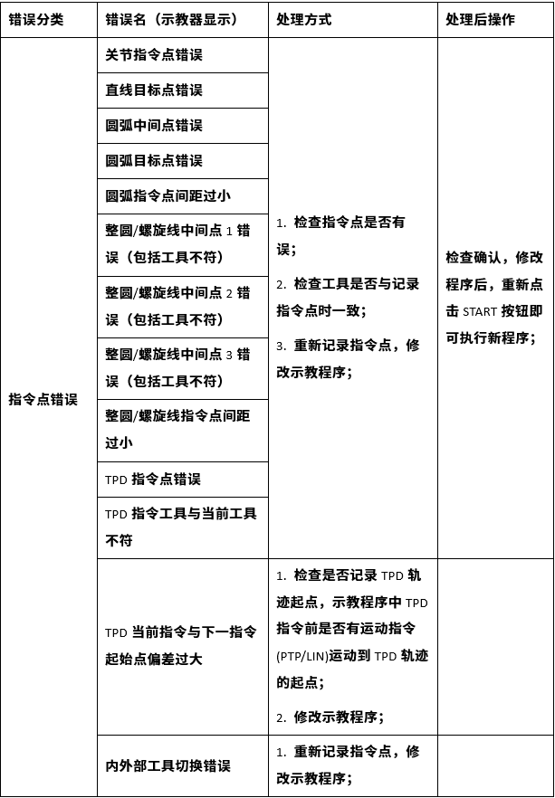
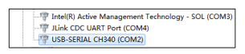
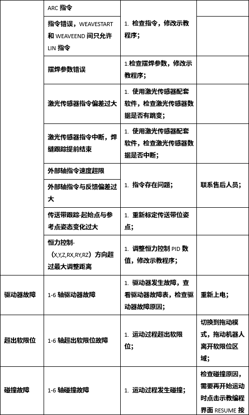
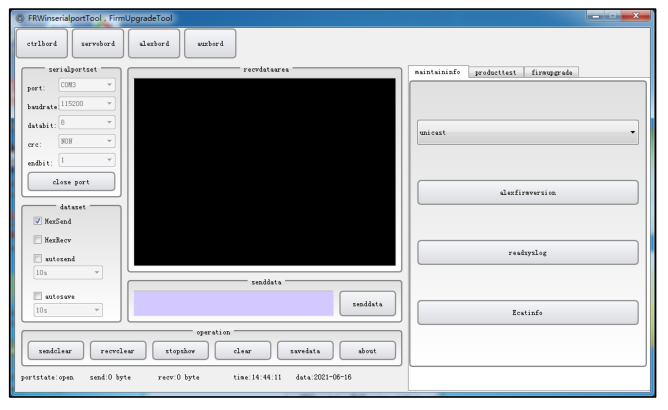
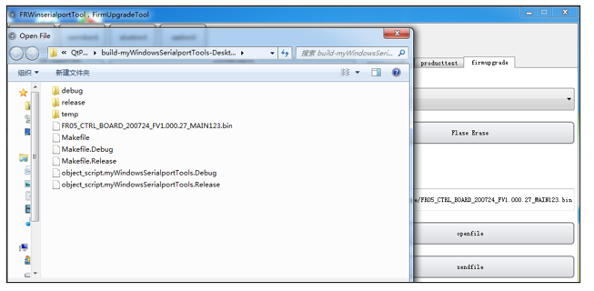
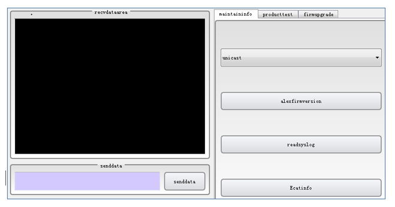
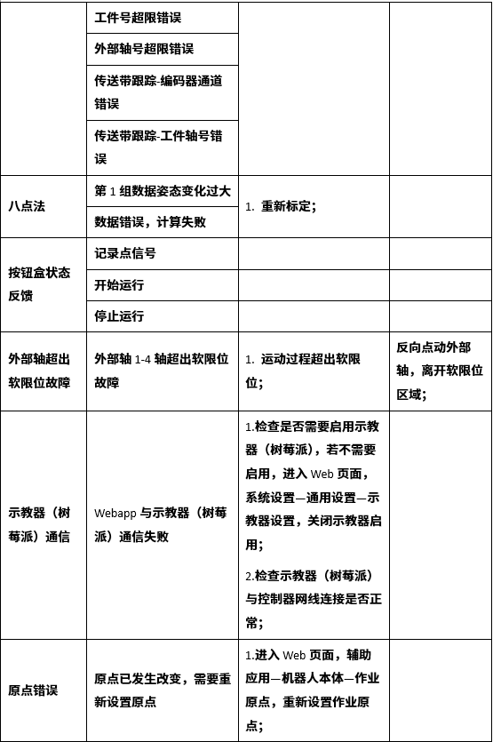

Appendix
==========

.. toctree:: 
  :maxdepth: 5

Appendix 1: Motion controller errors and handling methods
-----------------------------------------------------------------

.. csv-table:: 
   :header: "Main Fault Code", "Sub Fault Code", "Description"
   :widths: 20, 10, 70

   "0-No fault", "0", "No fault"
   "1-Command point error", "1", "Joint command point error, resettable"
   "1-Command point error", "2", "Line target point error (including tool mismatch), resettable"
   "1-Command point error", "3", "Arc intermediate point error (including tool mismatch), resettable"
   "1-Command point error", "4", "Arc target point error (including tool mismatch), resettable"
   "1-Command point error", "5", "Arc command point spacing too small, resettable"
   "1-Command point error", "6", "Full circle/helix intermediate point 1 error (including tool mismatch), resettable"
   "1-Command point error", "7", "Full circle/helix intermediate point 2 error (including tool mismatch), resettable"
   "1-Command point error", "8", "Full circle/helix intermediate point 3 error (including tool mismatch), resettable"
   "1-Command point error", "9", "Full circle/helix command point spacing too small, resettable"
   "1-Command point error", "10", "TPD command point error, resettable"
   "1-Command point error", "11", "TPD command tool does not match current tool, resettable"
   "1-Command point error", "12", "Deviation between TPD current command and next command start point too large, resettable"
   "1-Command point error", "13", "Internal/external tool switching error, resettable"
   "1-Command point error", "14", "New helix start point error, resettable"
   "1-Command point error", "15", "New spline curve command point error, resettable"
   "1-Command point error", "17", "PTP joint command over limit, resettable"
   "1-Command point error", "18", "TPD joint command over limit, resettable"
   "1-Command point error", "19", "LIN/ARC issued joint command over limit, resettable"
   "1-Command point error", "20", "Command overspeed in Cartesian space, not resettable"
   "1-Command point error", "21", "Torque command over limit in joint space, resettable"
   "1-Command point error", "22", "JOG joint command over limit, resettable"
   "1-Command point error", "23", "Axis 1 joint space command speed over limit, resettable"
   "1-Command point error", "24", "Axis 2 joint space command speed over limit, resettable"
   "1-Command point error", "25", "Axis 3 joint space command speed over limit, resettable"
   "1-Command point error", "26", "Axis 4 joint space command speed over limit, resettable"
   "1-Command point error", "27", "Axis 5 joint space command speed over limit, resettable"
   "1-Command point error", "28", "Axis 6 joint space command speed over limit, resettable"
   "1-Command point error", "29", "Joint feedback speed over limit, not resettable"
   "1-Command point error", "30", "Deviation between joint command and feedback too large, not resettable, restart required"
   "1-Command point error", "31", "DMP target point error (including tool mismatch), resettable"
   "1-Command point error", "33", "Next command joint configuration changed (next command has singular pose, please use PTP command or change next command point), resettable"
   "1-Command point error", "34", "Current command joint configuration changed (next command has singular pose, please use PTP command or change next command point), resettable"
   "1-Command point error", "35", "Joint speed over limit in LIN command, resettable"
   "1-Command point error", "36", "LIN command adaptive speed exceeds threshold, resettable"
   "1-Command point error", "37", "Unreachable point exists in trajectory, resettable"
   "1-Command point error", "38", "Unreachable point exists in trajectory - singular pose, resettable"
   "1-Command point error", "49", "Command error, only LIN and ARC commands are allowed between ARCSTART and ARCEND, resettable"
   "1-Command point error", "50", "Command error, only LIN and ARC commands are allowed between WEAVESTART and WEAVEEND, resettable"
   "1-Command point error", "51", "Weaving parameter error, resettable"
   "1-Command point error", "52", "Weaving command point spacing too small, resettable"
   "1-Command point error", "53", "Unreachable point exists in weaving trajectory - singular pose, resettable"
   "1-Command point error", "54", "Unreachable point exists in weaving trajectory - joint command over limit, resettable"
   "1-Command point error", "55", "Unreachable point exists in weaving trajectory - planning exception (tool z coincides with forward direction x angle), resettable"
   "1-Command point error", "56", "Unreachable point exists in weaving trajectory - planning exception (arc waypoint error), resettable"
   "1-Command point error", "65", "Laser sensor command deviation too large, resettable"
   "1-Command point error", "66", "Laser sensor command interrupted, weld seam tracking ended early, resettable"
   "1-Command point error", "81", "External axis command speed over limit, resettable"
   "1-Command point error", "82", "Deviation between external axis command and feedback too large, not resettable, homing or restart required"
   "1-Command point error", "83", "Extended peripheral (external axis/IO) communication abnormal, resettable"
   "1-Command point error", "84", "Extended peripheral (welder) communication abnormal, resettable"
   "1-Command point error", "85", "Extended 1 joint space command speed over limit, resettable"
   "1-Command point error", "86", "Extended 2 joint space command speed over limit, resettable"
   "1-Command point error", "87", "Extended 3 joint space command speed over limit, resettable"
   "1-Command point error", "88", "Extended 4 joint space command speed over limit, resettable"
   "1-Command point error", "89", "Extended peripheral (UDP) communication abnormal, resettable"
   "1-Command point error", "90", "Extended peripheral (UDP) communication packet loss abnormal, resettable"
   "1-Command point error", "97", "Conveyor tracking - pose change between start point and reference point too large, resettable"
   "1-Command point error", "113", "Constant force control - X direction exceeds maximum adjustment distance, resettable"
   "1-Command point error", "114", "Constant force control - Y direction exceeds maximum adjustment distance, resettable"
   "1-Command point error", "115", "Constant force control - Z direction exceeds maximum adjustment distance, resettable"
   "1-Command point error", "116", "Constant force control - RX direction exceeds maximum adjustment angle, resettable"
   "1-Command point error", "117", "Constant force control - RY direction exceeds maximum adjustment angle, resettable"
   "1-Command point error", "118", "Constant force control - RZ direction exceeds maximum adjustment angle, resettable"
   "1-Command point error", "119", "External sensor data error, resettable"
   "1-Command point error", "120", "Helix exploration motion failed, resettable"
   "1-Command point error", "121", "Rotational insertion motion failed, resettable"
   "1-Command point error", "122", "Linear insertion motion failed, resettable"
   "1-Command point error", "123", "Surface positioning motion failed, resettable"
   "1-Command point error", "129", "Maximum torque recording point count exceeded, resettable"
   "1-Command point error", "130", "Speed switching error, resettable"
   "1-Command point error", "131", "Tool direction over limit, resettable"
   "1-Command point error", "132", "Momentum over limit, resettable"
   "1-Command point error", "133", "Power over limit, resettable"
   "1-Command point error", "134", "STL-Flash diagnostic abnormal, resettable"
   "1-Command point error", "135", "STL-RAM diagnostic abnormal, resettable"
   "1-Command point error", "136", "STL-CPU diagnostic abnormal, resettable"
   "1-Command point error", "137", "Safety board II - ECAT safety data abnormal, resettable"
   "1-Command point error", "138", "Axis 1 - ECAT safety data abnormal, resettable"
   "1-Command point error", "139", "Axis 2 - ECAT safety data abnormal, resettable"
   "1-Command point error", "140", "Axis 3 - ECAT safety data abnormal, resettable"
   "1-Command point error", "141", "Axis 4 - ECAT safety data abnormal, resettable"
   "1-Command point error", "142", "Axis 5 - ECAT safety data abnormal, resettable"
   "1-Command point error", "143", "Axis 6 - ECAT safety data abnormal, resettable"
   "1-Command point error", "145", "Communication between safety board and control box abnormal, resettable"
   "1-Command point error", "146", "Focus following error, resettable"
   "1-Command point error", "147", "Attitude speed over limit, resettable"
   "1-Command point error", "148", "Joint status word abnormal, resettable"
   "1-Command point error", "149", "Function or setting conflict, resettable"
   "2-Driver fault", "1", "Axis 1 driver fault, not resettable"
   "2-Driver fault", "2", "Axis 2 driver fault, not resettable"
   "2-Driver fault", "3", "Axis 3 driver fault, not resettable"
   "2-Driver fault", "4", "Axis 4 driver fault, not resettable"
   "2-Driver fault", "5", "Axis 5 driver fault, not resettable"
   "2-Driver fault", "6", "Axis 6 driver fault, not resettable"
   "3-Soft limit exceeded fault", "1", "Axis 1 soft limit exceeded fault, resettable"
   "3-Soft limit exceeded fault", "2", "Axis 2 soft limit exceeded fault, resettable"
   "3-Soft limit exceeded fault", "3", "Axis 3 soft limit exceeded fault, resettable"
   "3-Soft limit exceeded fault", "4", "Axis 4 soft limit exceeded fault, resettable"
   "3-Soft limit exceeded fault", "5", "Axis 5 soft limit exceeded fault, resettable"
   "3-Soft limit exceeded fault", "6", "Axis 6 soft limit exceeded fault, resettable"
   "4-Collision fault", "1", "Axis 1 collision fault, resettable"
   "4-Collision fault", "2", "Axis 2 collision fault, resettable"
   "4-Collision fault", "3", "Axis 3 collision fault, resettable"
   "4-Collision fault", "4", "Axis 4 collision fault, resettable"
   "4-Collision fault", "5", "Axis 5 collision fault, resettable"
   "4-Collision fault", "6", "Axis 6 collision fault, resettable"
   "4-Collision fault", "7", "End collision fault, resettable"
   "4-Collision fault", "8", "External axis collision fault, resettable"
   "5-Active slave count error", "1", "Active slave count error, not resettable"
   "6-Slave error", "1", "Slave offline, not resettable"
   "6-Slave error", "2", "Slave status inconsistent with set value, not resettable"
   "6-Slave error", "3", "Slave not configured, not resettable"
   "6-Slave error", "4", "Slave configuration error, not resettable"
   "6-Slave error", "5", "Slave initialization error, not resettable"
   "6-Slave error", "6", "Slave mailbox communication initialization error, not resettable"
   "7-IO error", "1", "Channel error, resettable"
   "7-IO error", "2", "Value error, resettable"
   "7-IO error", "3", "WaitDI wait timeout, resettable"
   "7-IO error", "4", "WaitAI wait timeout, resettable"
   "7-IO error", "5", "WaitAxleDI wait timeout, resettable"
   "7-IO error", "6", "WaitAxleAI wait timeout, resettable"
   "7-IO error", "7", "Channel configured function error, resettable"
   "7-IO error", "8", "Arc start timeout, resettable"
   "7-IO error", "9", "Arc end timeout, resettable"
   "7-IO error", "10", "Seam finding timeout, resettable"
   "7-IO error", "11", "Conveyor IO detection timeout, resettable"
   "7-IO error", "12", "WaitAuxDI wait timeout, resettable"
   "7-IO error", "13", "WaitAuxAI wait timeout, resettable"
   "7-IO error", "14", "Wire seam finding timeout, resettable"
   "7-IO error", "15", "Safety stop triggered, resettable"
   "7-IO error", "16", "DO module 24V short circuit protection, not resettable"
   "7-IO error", "17", "Position holding (brake failure) protection, not resettable"
   "7-IO error", "18", "Board DI wait timeout, resettable"
   "7-IO error", "19", "Board AI wait timeout, resettable"
   "8-Gripper error", "1", "Gripper motion timeout error, resettable"
   "9-File error", "1", "zbt configuration file version error, initialization error - not resettable"
   "9-File error", "2", "zbt configuration file load failed, initialization error - not resettable"
   "9-File error", "3", "user configuration file version error, initialization error - not resettable"
   "9-File error", "4", "user configuration file load failed, initialization error - not resettable"
   "9-File error", "5", "exaxis configuration file version error, initialization error - not resettable"
   "9-File error", "6", "exaxis configuration file load failed, initialization error - not resettable"
   "9-File error", "7", "Robot model inconsistent, reconfiguration required - not resettable"
   "9-File error", "8", "dhpara configuration file version error, initialization error - not resettable"
   "9-File error", "9", "dhpara configuration file load failed, initialization error - not resettable"
   "9-File error", "10", "Robot model not set - not resettable"
   "9-File error", "11", "load configuration file version error, initialization error - not resettable"
   "9-File error", "12", "load configuration file load failed, initialization error - not resettable"
   "9-File error", "13", "speed configuration file version error, initialization error - not resettable"
   "9-File error", "14", "speed configuration file load failed, initialization error - not resettable"
   "9-File error", "15", "weavepara configuration file version error, initialization error - not resettable"
   "9-File error", "16", "weavepara configuration file load failed, initialization error - not resettable"
   "9-File error", "17", "interfere configuration file version error, initialization error - not resettable"
   "9-File error", "18", "interfere configuration file load failed, initialization error - not resettable"
   "9-File error", "19", "dynamic configuration file version error, initialization error - not resettable"
   "9-File error", "20", "dynamic configuration file load failed, initialization error - not resettable"
   "10-Singular pose", "1", "Singular pose"
   "11-Driver communication error", "1", "Axis 1 driver communication error, not resettable"
   "11-Driver communication error", "2", "Axis 2 driver communication error, not resettable"
   "11-Driver communication error", "3", "Axis 3 driver communication error, not resettable"
   "11-Driver communication error", "4", "Axis 4 driver communication error, not resettable"
   "11-Driver communication error", "5", "Axis 5 driver communication error, not resettable"
   "11-Driver communication error", "6", "Axis 6 driver communication error, not resettable"
   "12-External axis soft limit", "1", "Axis 1 soft limit exceeded, resettable"
   "12-External axis soft limit", "2", "Axis 2 soft limit exceeded, resettable"
   "12-External axis soft limit", "3", "Axis 3 soft limit exceeded, resettable"
   "12-External axis soft limit", "4", "Axis 4 soft limit exceeded, resettable"
   "13-Setting parameter error", "1", "Tool number over limit, resettable"
   "13-Setting parameter error", "2", "Positioning completion threshold error, resettable"
   "13-Setting parameter error", "3", "Collision level error, resettable"
   "13-Setting parameter error", "4", "Load weight error, resettable"
   "13-Setting parameter error", "5", "Load center of mass X error, resettable"
   "13-Setting parameter error", "6", "Load center of mass Y error, resettable"
   "13-Setting parameter error", "7", "Load center of mass Z error, resettable"
   "13-Setting parameter error", "8", "DI filtering time error, resettable"
   "13-Setting parameter error", "9", "AxleDI filtering time error, resettable"
   "13-Setting parameter error", "10", "AI filtering time error, resettable"
   "13-Setting parameter error", "11", "AxleAI filtering time error, resettable"
   "13-Setting parameter error", "12", "DI high/low level range error, resettable"
   "13-Setting parameter error", "13", "DO high/low level range error, resettable"
   "13-Setting parameter error", "14", "Workpiece number over limit, resettable"
   "13-Setting parameter error", "15", "External axis number over limit, resettable"
   "13-Setting parameter error", "16", "Conveyor encoder channel error, resettable"
   "13-Setting parameter error", "17", "Conveyor workpiece axis number error, resettable"
   "13-Setting parameter error", "18", "FR30L installation method error - not upright mounting, resettable"

Appendix 2: Wide Voltage Control Box Fault Table
---------------------------------------------------------------------------------

.. list-table::
   :widths: 20 40 80
   :header-rows: 0
   :align: center

   * - **Fault Code**
     - **Fault Name**
     - **Troubleshooting Method**

   * - 3
     - Auxiliary MCU Offline
     - | 1. Re-flash the auxiliary MCU firmware
       | 2. Repair the auxiliary MCU or replace the control box  

   * - 4
     - Main and Auxiliary MCU Emergency Stop Input Mismatch
     - | 1. Check the emergency stop wiring harness of the button box or replace the button box assembly
       | 2. Check the two emergency stop shorting wiring harnesses on the control box terminals  
       | 3. If the fault persists, repair or replace the control box 

   * - 5
     - Main and Auxiliary MCU Safety Input Mismatch
     - | 1. Check the two safety shorting wiring harnesses on the control box terminals
       | 2. If the fault persists, repair or replace the control box

   * - 6
     - Main and Auxiliary MCU 3-Position Enable and Emergency Stop Input Mismatch
     - | 1. Check the 3-position enable switch on the teach pendant and the teach pendant wiring harness
       | 2. Replace the teach pendant assembly
       | 3. Check whether the Web is in teach pendant mode and whether the teach pendant is connected
       | 4. If the fault persists, repair or replace the control box

   * - 7
     - Main STO Input/Output Mismatch
     - | 1. Check whether the control box heavy-load connector and STO wiring harness are securely plugged in
       | 2. Check whether the drive supports the STO function
       | 3. For wide-voltage certified control box + non-certified robot configuration, check whether functional safety mode is enabled
       | 4. The wide-voltage certified control box in certification mode enables STO fault detection; the non-certified robot does not support functional safety mode
       | 5. If the fault persists, repair or replace the control box

   * - 8
     - Auxiliary STO Input/Output Mismatch
     - | 1. Check whether the control box heavy-load connector and STO wiring harness are securely plugged in
       | 2. Check whether the drive supports the STO function
       | 3. For wide-voltage certified control box + non-certified robot configuration, check whether functional safety mode is enabled
       | 4. The wide-voltage certified control box in certification mode enables STO fault detection; the non-certified robot does not support functional safety mode
       | 5. If the fault persists, repair or replace the control box

   * - 9
     - Main MCU Detects 48V Relay Input/Output Mismatch
     - | 1. Check the input and feedback of the forced-guided relay in the control box
       | 2. Check whether the 48V relay in the control box is stuck
       | 3. Check whether the 48V relay feedback circuit in the control box is functioning properly
       | 4. If the fault persists, repair or replace the control box

   * - 10
     - Auxiliary MCU Detects 48V Relay Input/Output Mismatch
     - | 1. Check the input and feedback of the forced-guided relay in the control box
       | 2. Check whether the 48V relay in the control box is stuck
       | 3. Check whether the 48V relay feedback circuit in the control box is functioning properly
       | 4. If the fault persists, repair or replace the control box

   * - \
     - Control Box Power Off, No 48V Output
     - | 1. Check the 24V short-circuit protection chip related circuit and check for any short circuits on the 24V
       | 2. Check the emergency stop input & safety input terminal shorting wiring harnesses
       | 3. Check whether the 24V power supply daughter board in the control box outputs 24V
       | 4. If the fault persists, repair or replace the control box

Appendix 3: Servo Drive Fault Code Table
-------------------------------------------

.. list-table::
   :widths: 20 40 80
   :header-rows: 0
   :align: center

   * - **Fault Code**
     - **Fault Name**
     - **Troubleshooting Method**

   * - 1
     - Software overcurrent fault
     - | 1. Check whether the joint load or resistance has increased or is abnormal.
       | 2. If the fault persists, repair or replace the drive board.

   * - 2
     - Overvoltage fault
     - Reduce robot operating speed or acceleration.

   * - 3
     - Undervoltage fault
     - | 1. Check whether the 48V power supply output from the control box is abnormal.
       | 2. Check for short circuits between the drive board and the joint housing.
       | 3. If the fault persists, repair or replace the drive board.

   * - 4
     - Overtemperature fault
     - Reduce robot load or reduce robot operating speed.

   * - 5
     - Overload fault
     - Reduce robot load or reduce robot operating speed.

   * - 6
     - Overspeed fault
     - | 1. Check whether the set screw securing the magnetic encoder assembly to the motor shaft is loose.
       | 2. Re-perform encoder zeroing.
       | 3. If the fault persists, repair or replace the magnetic encoder assembly.

   * - 7
     - Parameter abnormal fault
     - Repair or replace the drive board.

   * - 8
     - Runaway fault
     - | 1. Check whether the set screw securing the magnetic encoder assembly to the motor shaft is loose.
       | 2. Re-perform encoder zeroing.
       | 3. If the fault persists, repair or replace the magnetic encoder assembly.

   * - 9
     - Position error fault
     - | 1. Check whether the joint load or resistance has increased or is abnormal.
       | 2. If the fault persists, repair or replace the drive board.

   * - 10
     - Position overflow fault
     - | 1. Check whether the hard limit stop is loose.
       | 2. Re-perform robot zeroing.

   * - 11
     - Hardware overcurrent fault
     - Repair or replace the drive board.

   * - 12
     - Drive inhibit fault
     - Not enabled.

   * - 13
     - Motor stall fault
     - | 1. Check whether the brake solenoid is engaged.
       | 2. Check whether the hard limit stop has been hit.
       | 3. If the fault persists, repair or replace the drive board.

   * - 14
     - Power supply fault
     - Not enabled.

   * - 15
     - STO fault
     - Not enabled.

   * - 16
     - Phase current AD zeroing fault
     - Repair or replace the drive board.

   * - 17
     - EEPROM fault
     - Repair or replace the drive board.

   * - 18
     - Hall sensor fault
     - | 1. Check whether the Hall sensor harness is securely connected, and check for short circuits or open circuits.
       | 2. If the fault persists, repair or replace the joint.

   * - 19
     - Encoder fault
     - Repair or replace the magnetic encoder assembly.

   * - 20
     - Encoder zeroing fault
     - | 1. Re-perform encoder zeroing.
       | 2. If the fault persists, repair or replace the magnetic encoder assembly.

   * - 21
     - Encoder Z-phase signal loss fault
     - Not enabled.

   * - 22
     - Encoder count fault
     - Not enabled.

   * - 23
     - Encoder multi-turn data overflow fault
     - Not enabled.

   * - 24
     - External clock fault
     - Repair or replace the drive board.

   * - 25
     - UVW phase sequence fault
     - Not enabled.

   * - 26
     - FPGA fault
     - Not enabled.

   * - 27
     - Homing fault
     - Not enabled.

   * - 28
     - Magnetic encoder fault
     - | 1. Check whether the set screw securing the magnetic encoder assembly to the motor shaft is loose.
       | 2. If the fault persists, repair or replace the magnetic encoder assembly.

   * - 29
     - Motor power cable disconnection fault
     - | 1. Check whether the motor power cable is securely connected, and check for short circuits or open circuits.
       | 2. If the fault persists, repair or replace the drive board.

   * - 30
     - EtherCAT fault
     - | 1. Check whether the Ethernet cable is securely connected, and check for short circuits or open circuits.
       | 2. If the fault persists, repair or replace the drive board.

   * - 31
     - EtherCAT_SM_DOG fault
     - | 1. Check whether the Ethernet cable is securely connected, and check for short circuits or open circuits.
       | 2. If the fault persists, repair or replace the drive board.

   * - 32
     - EtherCAT_FATALSYNC fault
     - | 1. Check whether the Ethernet cable is securely connected, and check for short circuits or open circuits.
       | 2. If the fault persists, repair or replace the drive board.

   * - 33
     - EtherCAT_SYNC fault
     - | 1. Check whether the Ethernet cable is securely connected, and check for short circuits or open circuits.
       | 2. If the fault persists, repair or replace the drive board.

   * - 34
     - EtherCAT_RFT fault
     - | 1. Check whether the Ethernet cable is securely connected, and check for short circuits or open circuits.
       | 2. If the fault persists, repair or replace the drive board.

   * - 35
     - Drive axis address fault
     - | 1. Re-configure the drive axis address.
       | 2. If the fault persists, repair or replace the drive board.

   * - 36
     - Robot zeroing fault
     - | 1. Re-perform robot zeroing.
       | 2. First use JLINK to erase the FLASH, then re-download the program and perform zeroing.
       | 3. If the fault persists, repair or replace the drive board.

   * - 37
     - Encoder communication fault
     - | 1. Check whether the encoder cable is securely connected, and check for short circuits or open circuits.
       | 2. If the fault persists, repair or replace the magnetic encoder assembly.

   * - 40
     - Magnetic encoder module fault - zeroing fault
     - | 1. Re-perform magnetic encoder assembly zeroing.
       | 2. If the fault persists, repair or replace the magnetic encoder assembly.

   * - 41
     - Magnetic encoder module fault - multi-turn fault
     - | 1. Check whether the set screw securing the magnetic encoder assembly to the motor shaft is loose.
       | 2. If the fault persists, repair or replace the magnetic encoder assembly.

   * - 42
     - Magnetic encoder module fault - multi-turn small magnetic encoder fault
     - | 1. Check whether the multi-turn small magnetic encoder chip is abnormal.
       | 2. If the fault persists, repair or replace the magnetic encoder assembly.

   * - 43
     - Magnetic encoder module fault - multi-turn large magnetic encoder fault
     - | 1. Check whether the multi-turn large magnetic encoder chip is abnormal.
       | 2. If the fault persists, repair or replace the magnetic encoder assembly.

   * - 44
     - Magnetic encoder module fault - single-turn magnetic encoder fault
     - | 1. Check whether the single-turn magnetic encoder chip is abnormal.
       | 2. If the fault persists, repair or replace the magnetic encoder assembly.

   * - 45
     - Magnetic encoder module fault - optical encoder fault
     - | 1. Check whether the optical encoder disc is contaminated or not securely adhered.
       | 2. If the fault persists, repair or replace the magnetic encoder assembly.

   * - 46
     - Robot type setting abnormal fault
     - | 1. Without powering off, check the firmware version number of the faulty drive.
       | 2. Re-configure the robot type.
       | 3. If the fault persists, repair or replace the drive board.

   * - 47
     - Brake voltage detection fault
     - | 1. Check whether the brake wiring is abnormal.
       | 2. Check whether the brake circuit is abnormal.

   * - 50
     - Position command abnormal fault
     - | 1. Check whether the position command sent by the host computer (controller) is abnormal (or if the position command changes abruptly).

   * - 51
     - Magnetic encoder module fault - optical encoder fault
     - | 1. Check whether the torque sensor wiring is abnormal.
       | 2. If the fault persists, repair or replace the torque sensor.
       
Appendix 4: End plate 485 upgrade
-----------------------------------------

During field use, it is possible to update the firmware to meet the new requirements. A new upgrade file (XX_XX_MAIN. bin) will be provided to upgrade the terminal board through the 485 interface (USB to 485 module is required). The upgrade steps are as follows:

**Step1: 485 wiring.** There is a 5Pin communication aviation connector at the end of the robot. The pin pin distribution and pin pin description of the aviation connector are shown in Fig. 1.Connect the 485 - A and 485 - B at the end of the robot with A and B of the USB to 485 tool using twisted pair cables.

.. centered:: Figure 18.3-1 Pin Pin Distribution of Aviation Connector

**Step2: hardware connection.** connect the USB end of the USB to 485 tool to the PC, and in the PC device manager, if the USB&485 tool is identified, the following interface will appear.

.. centered:: Figure 18.3-2 USB&485 Port Identification Description

**Step3:Upgrade the tool.** After the wiring is completed, open the "Fair Serial Port Debugging Assistant", click the "Terminal Board" button, and select the above identified serial port in the "Serial Port Parameter Setting" function. The baud rate is 115200, the data bit is 8, the check bit is none, and the stop bit is 1. Then open the serial port. After success, the prompt "Serial port opened successfully" will appear.

.. centered:: Figure 18.3-3 Serial Port Parameter Settings

**Step4:Firmware upgrade.** Select "End plate" and click "Firmware upgrade", as shown in the fig.

.. centered:: Figure 18.3-4 End Plate Firmware Upgrade

-  First, click "Flash Erase". After the erasure is successful, you will be prompted in the receiving data area that the erasure is successful.

-  Open the file (the file to be upgraded), select the path to store it, as shown below. After the selection, the file name to be upgraded will appear in the file name display box.

.. centered:: Figure 18.3-5 Select Upgrade File

-  Click "Send File", and when the progress bar displays 100%, it means that the upgrade file has been sent.

**Step5:Upgrade verification.** The system is restarted and powered on. In the "Maintenance Information" column, select "Query terminal board firmware version information", and the firmware version information will be displayed in the "Receive Data Area". If it is consistent with the upgraded file version information, the upgrade is successful, otherwise the upgrade fails.

.. centered:: Figure 18.3-6 Querying Firmware Version Information

Appendix 5: Control Box 485 Upgrade
----------------------------------------

There is a "power communication" interface on the robot control box board, and USB&485 tools A and B are respectively connected to the "485-A" and "485-B" of its interface.

The upgrade process is the same as that of the terminal board, and the software can be selected accordingly, which will not be repeated here.

.. centered:: Figure 18.4-1 Power Communication Interface

Appendix 6: List of Spare Parts and Vulnerable Parts
-------------------------------------------------------------

+----------------------------+----------------+-------------------+
|      Spare Part Name       |    Part No.    | Quantity/piece(s) |
+============================+================+===================+
| M8 * 30 screw              | 4.0.08.2006185 | 4                 |
+----------------------------+----------------+-------------------+
| Straight pin A type 8 * 20 | 4.5.00.2013076 | 2                 |
+----------------------------+----------------+-------------------+
| Fuse 5x20 6A               | /              | 1                 |
+----------------------------+----------------+-------------------+