Safety
===============

.. toctree:: 
   :maxdepth: 6

Background
------------------------------------------------
As a key execution unit in the development of industrial intelligent manufacturing, the safety performance of industrial robots has become a core element in the full lifecycle management of equipment. Currently, the industry generally requires that safety function-related parameters be固化 and tamper-proof, and that a complete and traceable verification mechanism be established to meet stringent safety compliance audit requirements.
System integrators and end users in Europe have further put forward clear requirements for transparency and verifiability of safety configurations in actual project acceptance. Specifically, after safety function debugging is completed, the system should be able to automatically generate a safety configuration report containing a complete checksum, and this checksum must be displayed in real-time on the device's web management interface. This mechanism is designed to ensure that any modifications to safety parameters can be effectively identified and recorded, thus providing a reliable basis for equipment safety status assessment, on-site acceptance, and subsequent operation and maintenance.
In view of this, the safety architecture design of this device not only complies with relevant international safety standards but also has built-in safety configuration export and checksum real-time display functions, to assist operators and safety managers in conveniently and reliably completing configuration confirmation and compliance certification work.

Safety Configuration Checksum
------------------------------------------------

Open the web page. The safety checksum is located in the upper right corner of the page, represented by an 8-digit hexadecimal number. The safety checksum is unique; when safety configuration parameters change, the safety checksum changes accordingly.

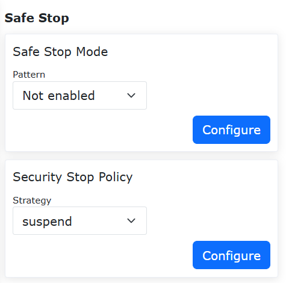

.. centered:: Figure 7.1-1 Safety Configuration Checksum Display

Click on the safety checksum to display the set of safety configuration parameters represented by the current safety checksum.

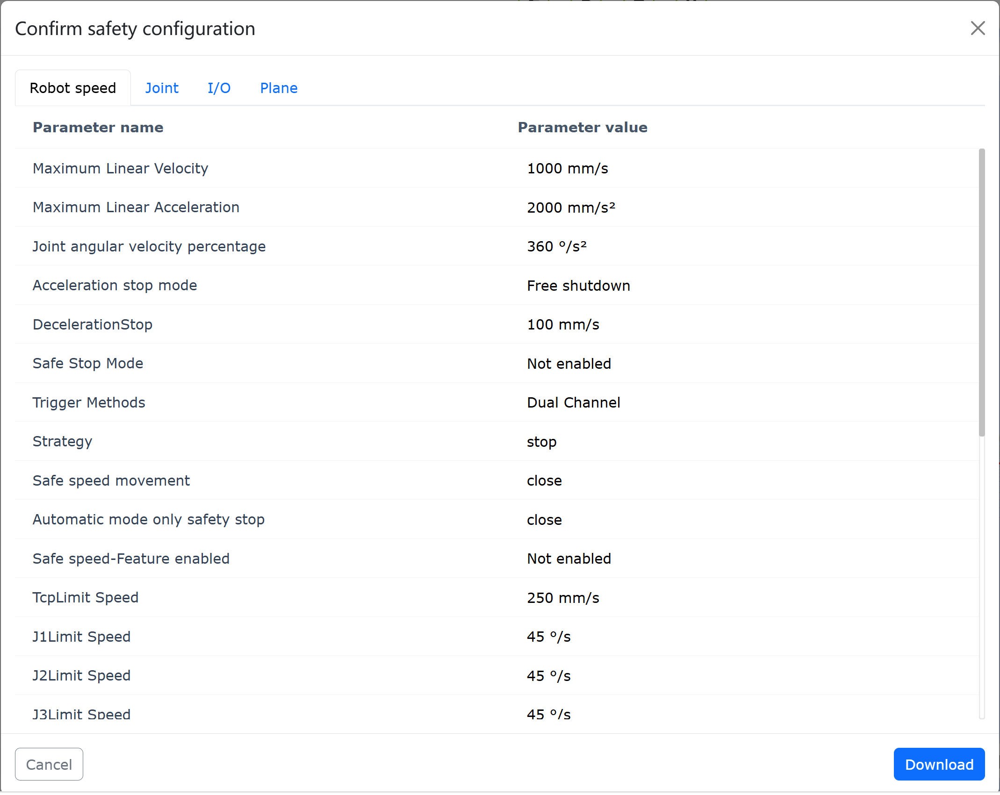

.. centered:: Figure 7.1-2 Safety Configuration Parameters

Safety configuration parameters support exporting PDF reports. Click Download to preview the PDF report, and it also supports export. Click the Save button to download the PDF report.

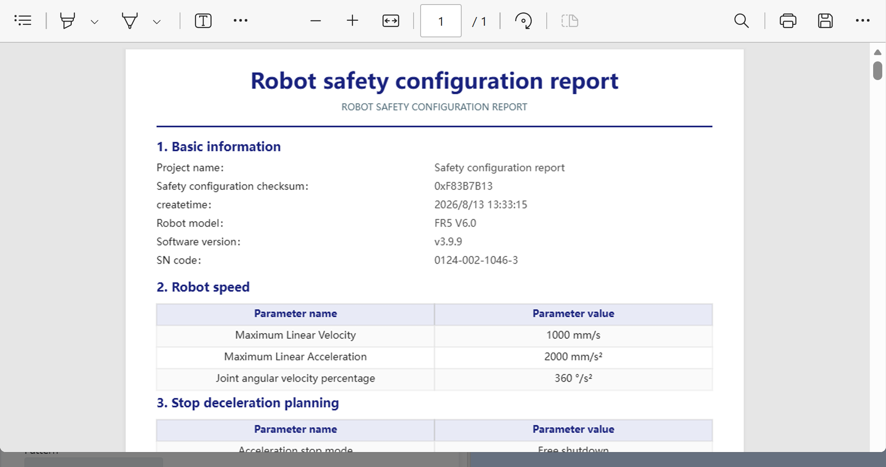

.. centered:: Figure 7.1-3 Safety Configuration Report PDF Preview

Safety Configuration Parameter Management
------------------------------------------------

All robot-related safety configuration parameters are maintained uniformly on the web page under "Initial Setup" -> "Safety". Modifying safety configuration parameters requires first entering the "Safety Configuration Password" for verification. Only after successful verification can safety parameter configuration modifications be made.

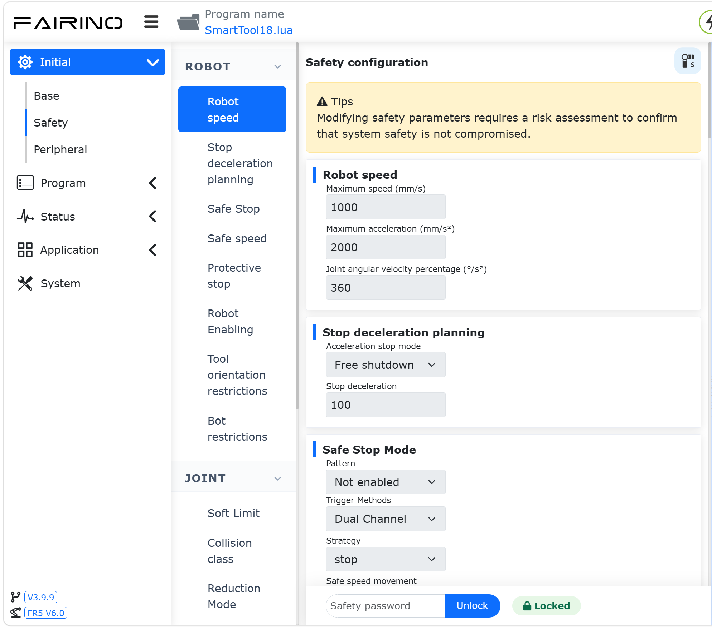

.. centered:: Figure 7.2-1 Safety Configuration Password Verification

After modifying the safety configuration parameters, click "Apply". A second confirmation of the modified safety configuration parameters is required. Click "Confirm" to apply the parameters. After the parameters are successfully applied, the safety configuration checksum will be updated accordingly.

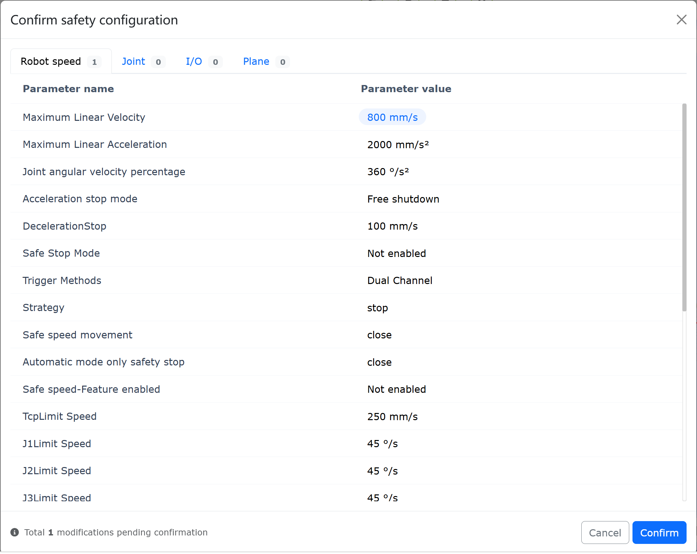

.. centered:: Figure 7.2-2 Safety Configuration Parameters Second Confirmation

Cybersecurity Functions
------------------------------------------------------------------------

Security Password Management
~~~~~~~~~~~~~~~~~~~~~~~~~~~~~~~~~~~~~~~~~~~~~~~~~~~~~~~~~~~~~~~~~~~~~~~~~~~~~~

Security Password Modification
+++++++++++++++++++++++++++++++++++++++++++++++++++++++++++++++++++++

The default security password is "12345678". The security password can be modified on the "Safety" page. Click the "Modify Security Password" button to open the security password modification window. Enter the old password and the new password respectively to complete the security password modification.

.. centered:: Figure 7.3-1 Security Password Modification Button

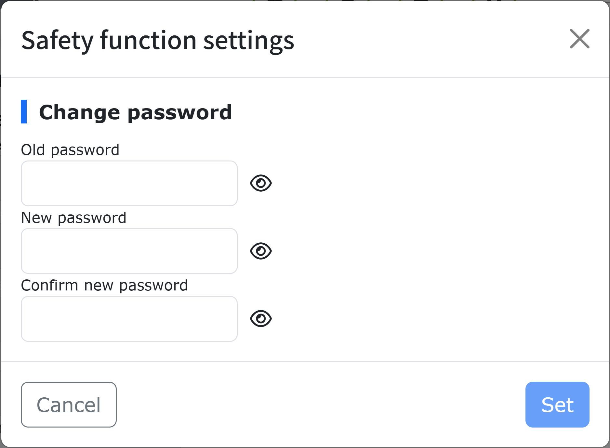

.. centered:: Figure 7.3-2 Security Password Modification Window

The new and old security passwords must not be the same. The security password must be at least 8 characters long and must contain uppercase and lowercase letters, digits, and special characters.

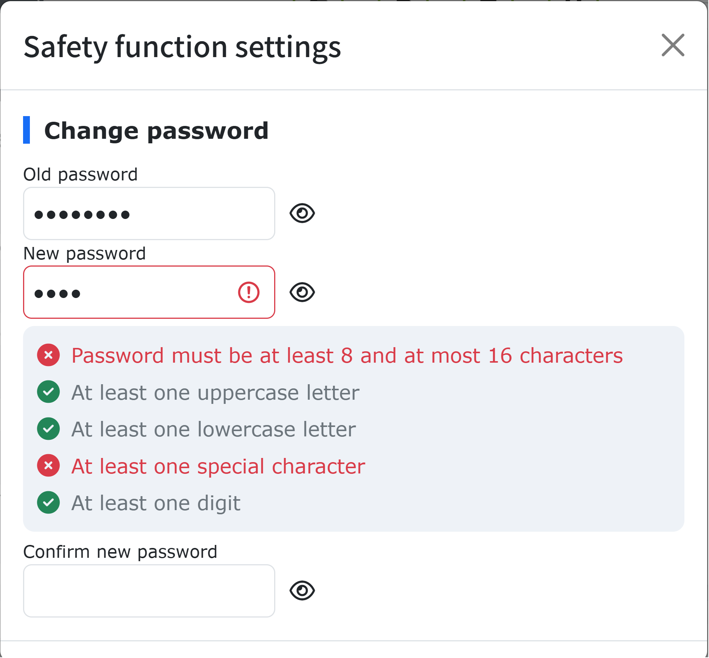

.. centered:: Figure 7.3-3 Security Password Complexity Verification

Security Password Protection
+++++++++++++++++++++++++++++++++++++++++++++++++++++++++++++++++++++

The robot security password input unlock has an anti-brute-force function. If an incorrect password is entered 5 consecutive times and the interval between each attempt is less than 1 minute, the security password input will be locked for 1 minute. During this 1 minute, the password cannot be entered to unlock, and a countdown is displayed in the WebApp.

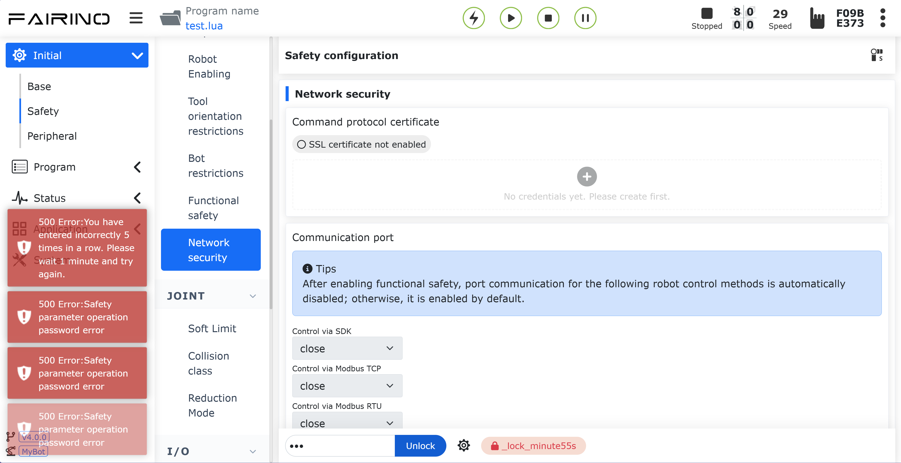

.. centered:: Figure 7.3-4 Security Password Anti-Brute-Force Lockout

Cybersecurity
~~~~~~~~~~~~~~~~~~~~~~~~~~~~~~~~~~~~~~~~~~~~~~~~~~~~~~~~~~~~~~~~~~~~~~~~

The robot cybersecurity functions include encrypted communication of command protocols, default disabling of non-encrypted communication ports, software upgrades, integrity verification during startup, etc., which are used for identity authentication, anti-eavesdropping and anti-tampering, resisting network attacks, and ensuring controllable and secure communication.

Network Security Environment Information
+++++++++++++++++++++++++++++++++++++++++++++++++++++++++++++++++++++

Users must meet the following environmental requirements to ensure that the collaborative robot network security functions are effective; if the environment does not meet the requirements, the collaborative robot's security protection capability may be reduced, and security risks may exist.

Physical Security Environment
*******************************************************************************

① The robot controller and any switches it passes through must be installed in a control cabinet equipped with a locking device. Unauthorized personnel are strictly prohibited from opening the cabinet door. Without authorization, it is forbidden to touch the controller's Ethernet ports and safety I/O ports or any other interfaces.

② The robot controller Ethernet port is only used to connect to an industrial computer. It is forbidden to connect a personal computer directly or to connect to the controller network port through a switch. Unauthorized personnel are prohibited from touching the industrial computer that has a network connection with the robot. Set a login password for the industrial computer.

③ The robot teach pendant and button box should both be placed in a safe working area. Unauthorized personnel are prohibited from entering this area.

Robot Security Configuration
*******************************************************************************

① Set WebApp login accounts with corresponding permissions for personnel with different permissions, especially permissions for software/firmware upgrades and security parameter configuration;

② Change the robot WebApp administrator login password and security configuration password; keep the passwords properly to avoid leakage;

③ When using command protocol communication, enable encryption, and keep properly any network communication encryption certificates downloaded from the robot. Leakage of certificates is strictly prohibited.

④ Keep non-encrypted communication ports disabled by default; do not enable them unless necessary.

Network Security Function Version Requirements
+++++++++++++++++++++++++++++++++++++++++++++++++++++++++++++++++++++

Robot software version V4.0.0 and above supports network security functions. Robot software lower than this version number does not support network security functions.

WebApp Communication Encryption
+++++++++++++++++++++++++++++++++++++++++++++++++++++++++++++++++++++

Robot WebApp communication uses TLS 1.2 HTTPS encrypted communication. When using the WebApp, a certificate must be installed (if the certificate is not installed, the browser will display an insecure connection). The specific steps are as follows:

① Enter the robot IP address in the browser, such as 192.168.58.2, and press Enter to access the robot WebApp page. At this time, the browser will display an insecure connection prompt.

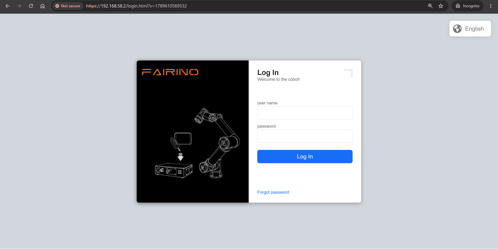

.. centered:: Figure 7.3-5 Insecure Connection Displayed

② Click "Not secure" on the left side of the IP address input box to open the connection details window.

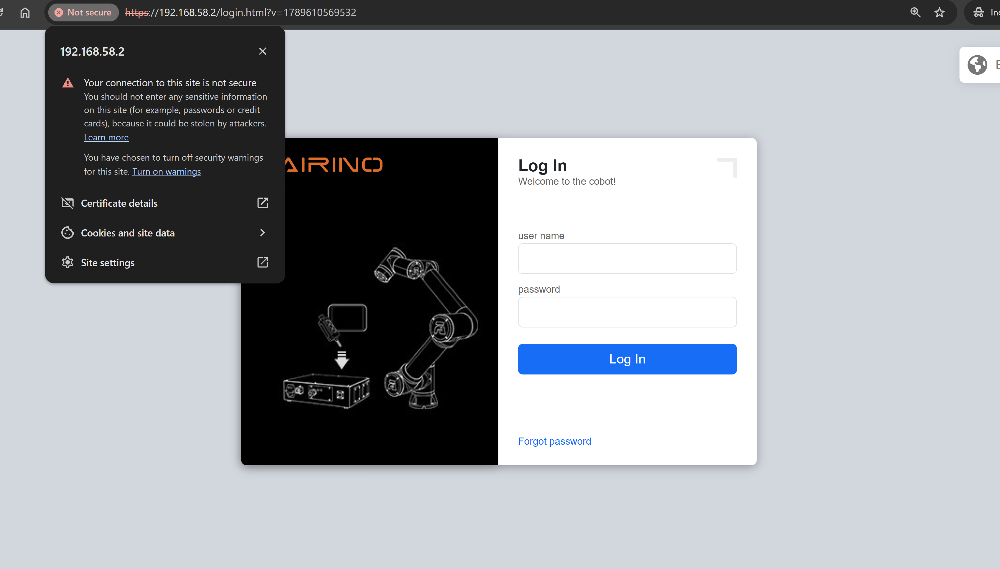

.. centered:: Figure 7.3-6 Connection Details Window Opened

③ In the window, click "Certificate details" to open the certificate details window. Select "Details" in the upper tab and click the "Export" button to download the certificate. The downloaded certificate name is usually the robot IP address. You need to rename the file and add the extension ".crt", for example, change "192.168.58.2" to "192.168.58.2.crt".

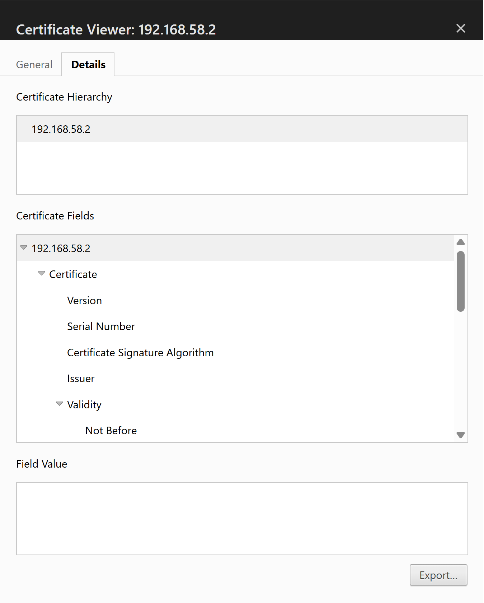

.. centered:: Figure 7.3-7 Certificate Details Window

.. image:: safety/053.png
   :width: 4in
   :align: center

.. centered:: Figure 7.3-8 Certificate File Name

④ Double-click the certificate file to open the certificate installation window, and click "Install Certificate".

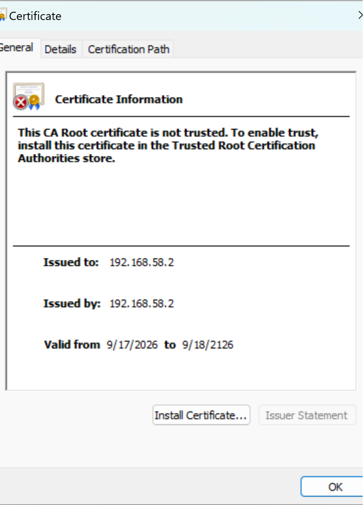

.. centered:: Figure 7.3-9 Certificate Installation Window

⑤ In the certificate installation wizard that pops up, select the storage location as Local Machine, and click Next.

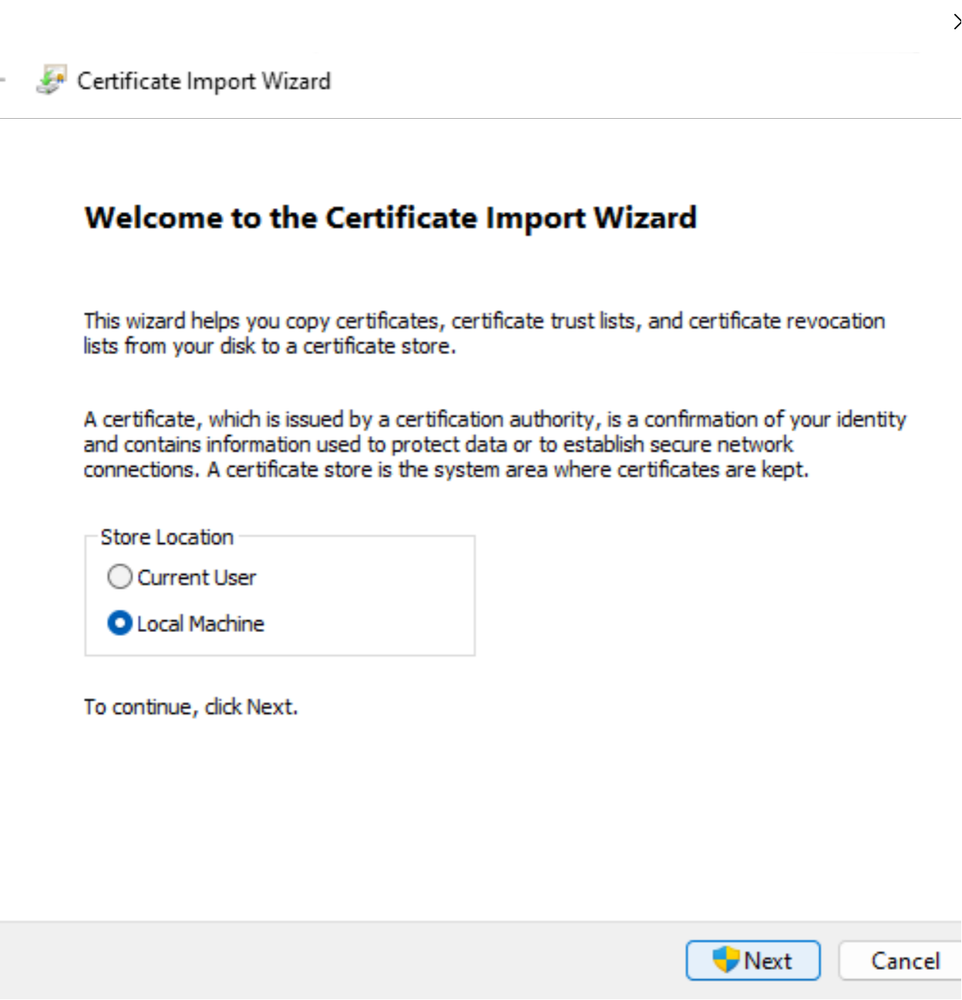

.. centered:: Figure 7.3-10 Select Storage Location as Local Machine

⑥ In the certificate wizard window, select "Place all certificates in the following store", click the "Browse" button, and select "Trusted Root Certification Authorities". Click Next.

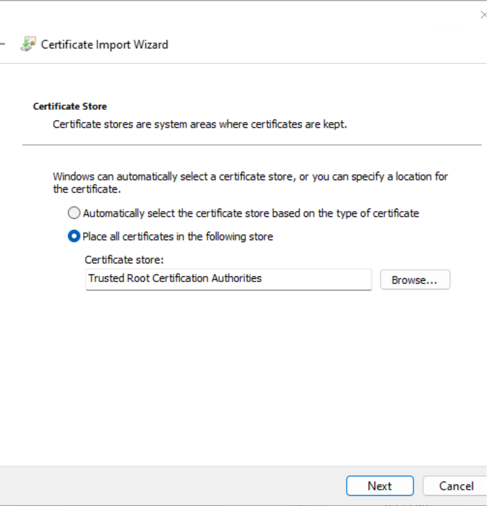

.. centered:: Figure 7.3-11 Select Trusted Root Certification Authorities

⑦ Click "Finish".

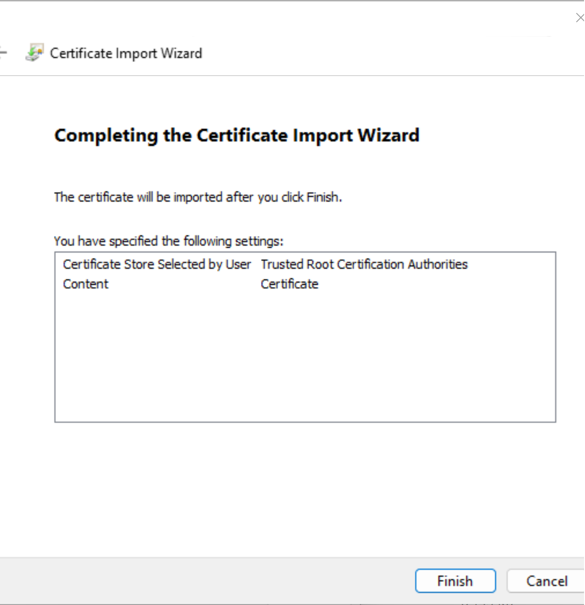

.. centered:: Figure 7.3-12 WebApp Certificate Installation Complete

Restart the browser and log in to the WebApp, and it will display as a normal secure connection.

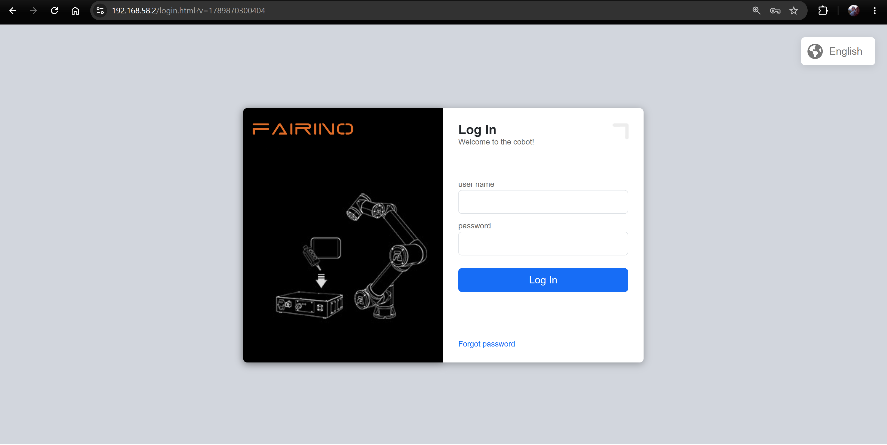

.. centered:: Figure 7.3-13 Secure Connection Displayed After Installing WebApp Certificate

Command Protocol Encryption
+++++++++++++++++++++++++++++++++++++++++++++++++++++++++++++++++++++

The robot 8080-TCP and 20007-UDP command protocols can be configured to communicate via TLS 1.2 mutual authentication encryption. Users download the root certificate, client certificate, and client private key from the robot. Each robot has its own separate root certificate, and client certificates and private keys downloaded from different robots cannot be mixed. A single robot supports only one set of client certificate and private key.

In the robot WebApp, click "Initial Setup", "Safety", "Cybersecurity" in sequence, enter the security password to unlock, and find "Command Protocol Certificate" in "Cybersecurity".

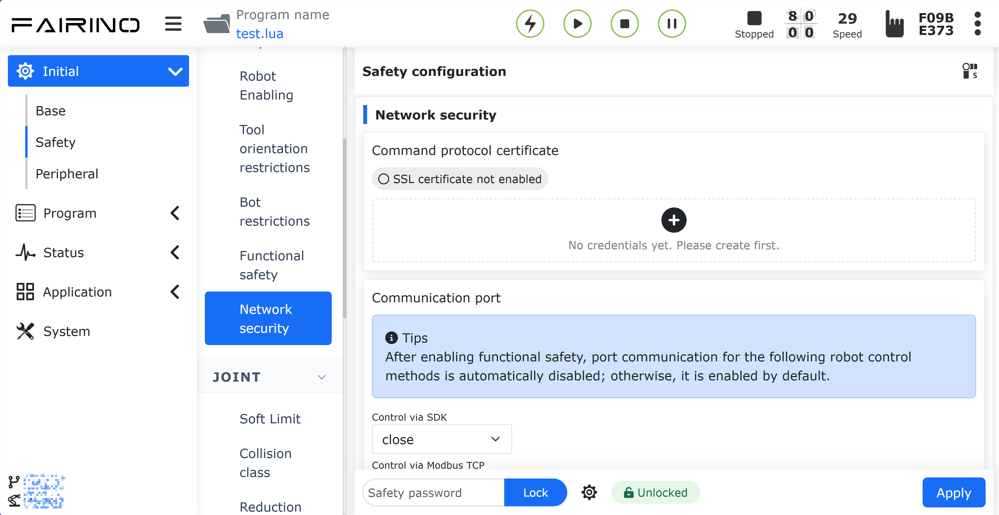

.. centered:: Figure 7.3-14 Command Protocol Certificate Configuration Page

Click the "No certificate yet, please create first" button, and enter the number of valid days for the command protocol certificate starting from the current day. Click the "Create" button. After the certificate is successfully created, the client certificate name, serial number, and expiration time calculated based on the valid days will be displayed.

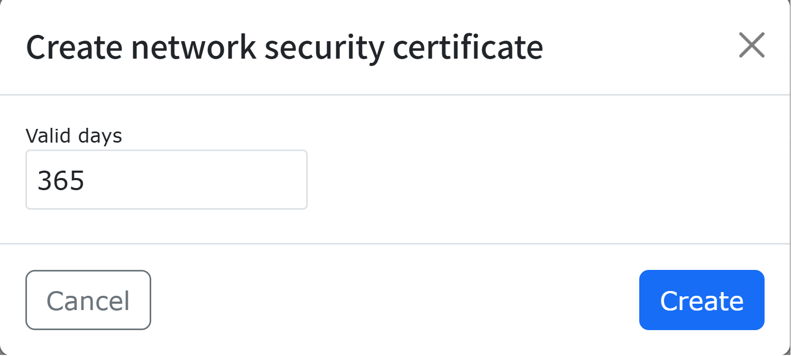

.. centered:: Figure 7.3-15 Command Protocol Certificate Validity Period Configuration

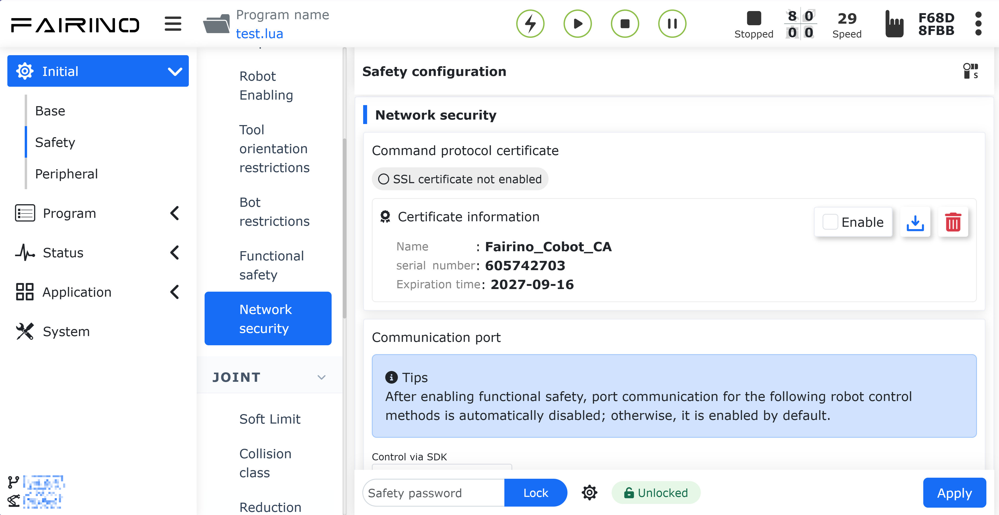

.. centered:: Figure 7.3-16 Command Protocol Certificate Information

Click the download button on the right to download the "client_certs.tar.gz" archive. The archive contains three files: "ca.crt": root certificate; "client.crt": client certificate; "client.key": client key.

Click "Enable" and click the "Apply" button. In the robot safety configuration confirmation window that pops up, confirm the enablement of command protocol certificate encryption, and click the "Confirm" button again to enable command protocol encryption.

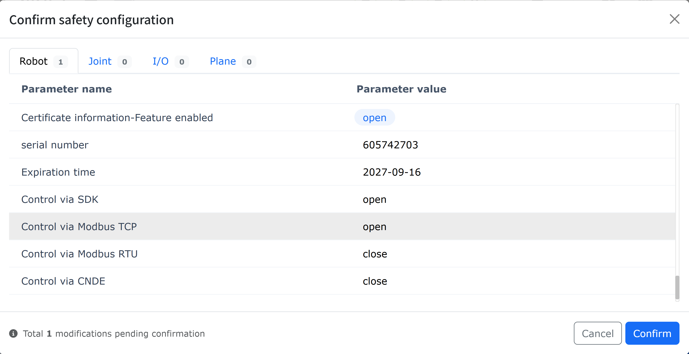

.. centered:: Figure 7.3-17 Command Protocol Certificate Enablement Confirmation

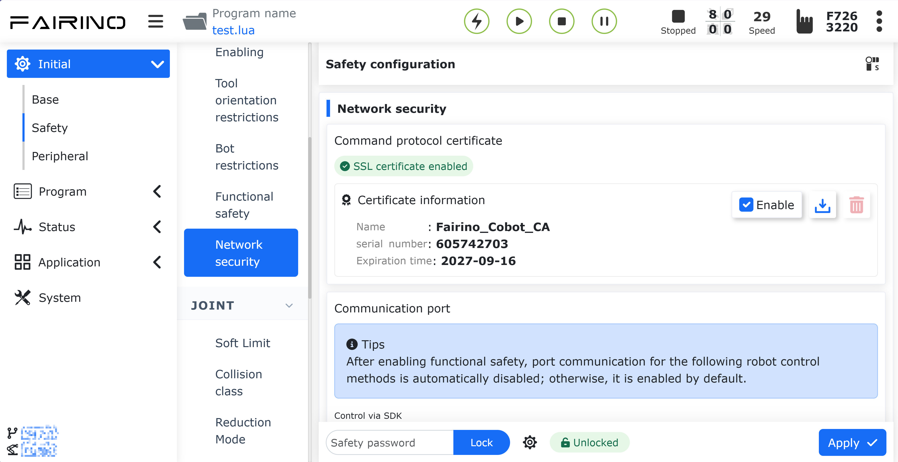

.. centered:: Figure 7.3-18 Command Protocol Certificate Encryption Enabled

Click the "Delete" button on the right side of the certificate information box to disable the certificate corresponding to that serial number. Before deleting the certificate, the command protocol encryption must first be set to disabled.

Non-Encrypted Network Communication Function Enablement Configuration
+++++++++++++++++++++++++++++++++++++++++++++++++++++++++++++++++++++

Some non-encrypted network communication functions of the robot can be configured to be enabled or disabled, and are disabled by default.

.. note:: Note: The robot communication port disabling function only takes effect when "Functional Safety" is enabled. In non-"Functional Safety" mode, all robot network communication functions are enabled!

In the robot WebApp, click "Initial Settings", "Safety", and "Network Security" in sequence, then find "Communication Ports". The functions of each port are described as follows:

.. centered:: Figure 7.3-19 Communication Port Enablement Configuration

- **Control via SDK**: Control the robot through the XMLRPC communication port in the robot SDK. When not enabled, the robot cannot be controlled via XMLRPC.
- **Control via ModbusTCP**: When the robot acts as a ModbusTCP slave, the robot DO output, program start/stop, manual/auto switching, reduced mode, etc. can be controlled through "Function Digital Input (Coil)". After disabling "Control via ModbusTCP", the above control functions through "Function Digital Input (Coil)" are all disabled.
- **Control via ModbusRTU**: When the robot acts as a ModbusRTU slave, the robot DO output, program start/stop, manual/auto switching, reduced mode, etc. can be controlled through "Function Digital Input (Coil)". After disabling "Control via ModbusRTU", the above control functions through "Function Digital Input (Coil)" are all disabled.
- **Control via CNDE**: The robot CNDE input can be configured for robot DO output, AO output, running speed, and other controls. After disabling "Control via CNDE", the CNDE client cannot control the above functions.
- **Button Box IP Reset Function**: The robot button box V2.0 has an IP reset button. Disabling the "Button Box IP Reset Function" will prevent the robot IP from being reset through the button box.
- **Control via port 8082**: The robot port 8082 is the upload port for LUA files and TPD trajectory recording files. Through this port, the content and name of the current motion LUA file can be modified. When the configuration is not enabled, the robot will not respond to the client's file modification requests.
- **Control via NTP**: The LA version control box has an NTP time synchronization service. Disabling this function prohibits the robot from performing NTP time synchronization.
- **Control via DHCP**: When turned off, the robot disables the DHCP service.

Enter the security password on the safety configuration page and unlock it, set the communication ports to be enabled to "On", click "Apply", confirm the enabled functions in the safety configuration confirmation window that pops up, and click the "Confirm" button.

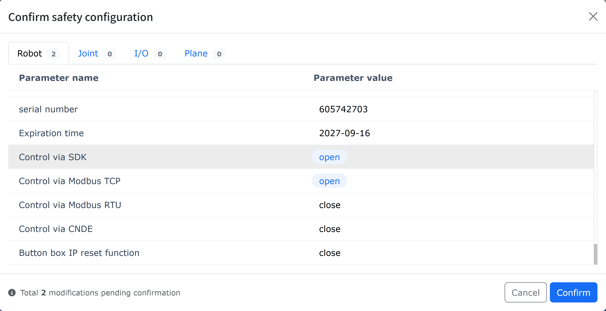

.. centered:: Figure 7.3-20 Communication Port Enablement Confirmation

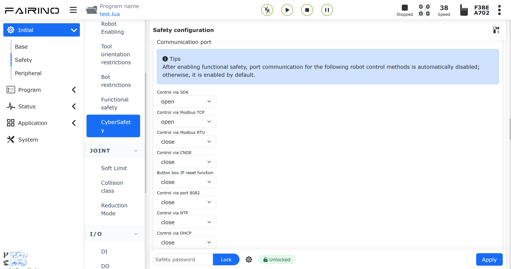

.. centered:: Figure 7.3-21 Communication Ports Enabled

Robot PTP Time Synchronization Service Enablement Configuration
++++++++++++++++++++++++++++++++++++++++++++++++++++++++++++++++++++++++++++++++++++++++++
The robot PTP time synchronization service can be configured as disabled, software time synchronization, or hardware time synchronization, and the robot control box network ports Eth0 and Eth1 for the PTP time synchronization service can be set. The "Logging" and "Synchronization Accuracy Detection" functions are not yet available.

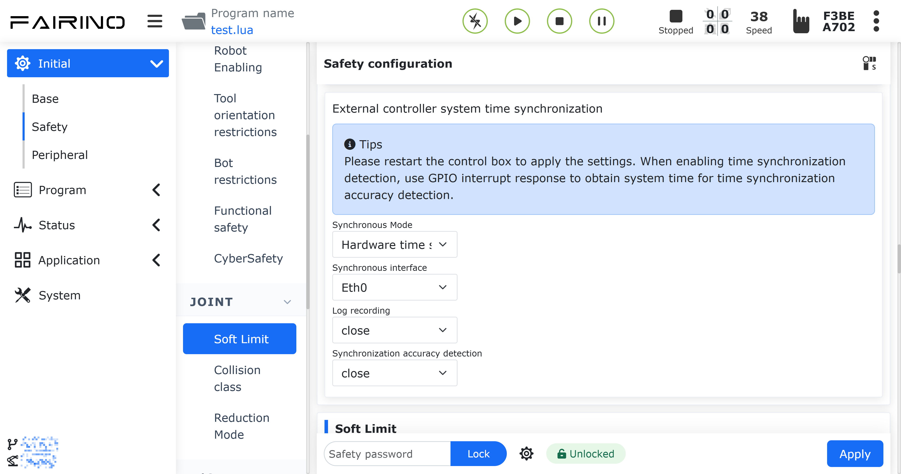

.. centered:: Figure 7.3-21-1 Robot PTP time synchronization service configuration

Robot Control Box Physical Tamper Protection
++++++++++++++++++++++++++++++++++++++++++++++++++++++++++++++++++++++++++++++++++++++++++
The robot control box has a physical tamper-evident label. Users need to regularly check whether the tamper-evident label on the robot control box is normal.

Robot Software Integrity Verification
+++++++++++++++++++++++++++++++++++++++++++++++++++++++++++++++++++++

Robot software upgrade and software startup will perform integrity verification of the software package to prevent the robot software package from being tampered with.

Robot software upgrade integrity verification: During robot software upgrade, the integrity of the software package to be upgraded will be verified. If the software package is incomplete, an error message will be reported during the upgrade and the upgrade will be stopped.

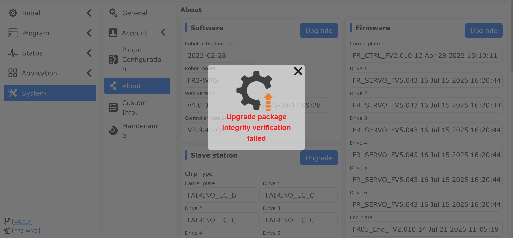

.. centered:: Figure 7.3-22 Software Upgrade Integrity Verification Failure Error

Robot software startup integrity verification: During robot software startup, the integrity of the software package in the current system will be verified. If the software package is complete, the robot software will start normally; otherwise, the robot software will not start, and an error prompt will be displayed in the WebApp.

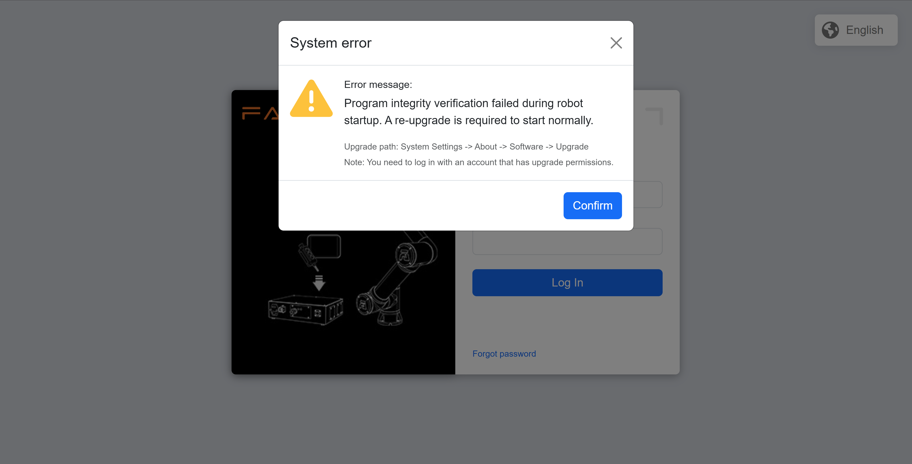

.. centered:: Figure 7.3-23 Integrity Verification Failure Error During Software Startup

Cybersecurity Residual Risk Statement
+++++++++++++++++++++++++++++++++++++++++++++++++++++++++++++++++++++

.. centered:: Table 2-1 Cybersecurity Residual Risks and User Compensatory Measures

.. list-table::
   :widths: 10 20 25 45
   :header-rows: 0
   :align: center

   * - **No.**
     - **Residual Risk**
     - **Mitigation Measures Taken**
     - **User Compensatory Measures**

   * - 1
     - Robot SDK - XMLRPC communication protocol is transmitted in plaintext
     - | ① SDK control robot function is disabled by default;
       | ② The SDK inherently integrates 8080-TCP and 20007-UDP command protocols, and the command protocols have TLS 1.2 encryption; if the command protocol encryption handshake fails, the SDK cannot connect to the robot normally.
     - | ① SDK communication between the host computer and the robot shall only be deployed in a trusted isolated network environment; connection to untrusted networks is not allowed; physical protection shall be provided for network links and network ports to prevent unauthorized access;
       | ② The SDK integrates 20007-UDP command protocol communication and provides the SendUDPFrame() interface for sending custom command frames. At the same time, 20007-UDP command protocol communication has DTLS encryption. Sensitive information must be sent to the robot through this interface;
       | ③ When not necessary, disable the SDK control robot function in the WebApp "Safety" and "Cybersecurity" modules;

   * - 2
     - Robot 20005 - TCP / 20006 - UDP configurable data exchange CNDE communication is transmitted in plaintext
     - | ① CNDE control robot function is disabled by default;
     - | ① CNDE communication between the host computer and the robot shall only be deployed in a trusted isolated network environment; connection to untrusted networks is not allowed; physical protection shall be provided for network links and network ports to prevent unauthorized access;
       | ② When not necessary, disable the CNDE control robot function in the WebApp "Safety" and "Cybersecurity" modules;

   * - 3
     - Robot ModbusTCP communication is transmitted in plaintext
     - | ① ModbusTCP control robot function is disabled by default;
     - | ① ModbusTCP communication between the host computer and the robot shall only be deployed in a trusted isolated network environment; connection to untrusted networks is not allowed; physical protection shall be provided for network links and network ports to prevent unauthorized access;
       | ② When not necessary, disable the ModbusTCP control robot function in the WebApp "Safety" and "Cybersecurity" modules;

   * - 4
     - Robot ModbusRTU communication is transmitted in plaintext
     - | ① ModbusRTU control robot function is disabled by default;
     - | ① ModbusRTU communication between the host computer and the robot shall only be deployed in a trusted isolated network environment; connection to untrusted networks is not allowed; physical protection shall be provided for network links and network ports to prevent unauthorized access;
       | ② When not necessary, disable the ModbusRTU control robot function in the WebApp "Safety" and "Cybersecurity" modules;

   * - 5
     - Attackers may use the default WebApp administrator login account and password to modify robot safety configuration parameters
     - No
     - | ① Users must modify the robot WebApp default administrator login password and keep the password properly;
       | ② Users must set corresponding WebApp login accounts and passwords for personnel with different safety configuration permissions and keep the passwords properly;

   * - 6
     - Attackers may use the default WebApp login account and password to modify the robot software/firmware version
     - No
     - | ① Users must modify the robot WebApp default administrator login password and keep the password properly;
       | ② Users must set corresponding WebApp login accounts and passwords for personnel with different software/firmware upgrade permissions and keep the passwords properly;

   * - 7
     - Attackers may use the default security password to modify safety configuration parameters
     - No
     - | ① Users must modify the robot security password and are prohibited from using the default security password;

   * - 8
     - Attackers may physically damage the robot LAN1 / LAN2 Ethernet ports, causing the robot Ethernet communication to fail
     - None
     - | ① Users must install the robot control box in a control cabinet with a locking device and prohibit unauthorized personnel from touching the robot control box;

   * - 9
     - Attackers may physically damage the robot RS-485 communication port, causing the robot extended axis control and ModbusRTU communication to fail
     - None
     - | ① Users must install the robot control box in a control cabinet with a locking device and prohibit unauthorized personnel from touching the robot control box;

   * - 10
     - Attackers may physically damage the emergency stop button on the robot button box, causing the robot emergency stop button to fail
     - None
     - | ① Users must place the robot button box in a safe working area and prohibit unauthorized personnel from entering the area;

   * - 11
     - Attackers may physically damage the emergency stop button on the robot teach pendant, causing the robot emergency stop button to fail
     - None
     - | ① Users must place the robot teach pendant in a safe working area and prohibit unauthorized personnel from entering the area;

Safety Configuration Parameters
--------------------------------------------------------------------------------------------------

Robot Safety Parameters
~~~~~~~~~~~~~~~~~~~~~~~~~~~~~~~~~~~~~~~~~~~~~~~~~~~~~~~~~~~~~~~~~~~~~~~

Robot Speed
++++++++++++++++++++++++++++++++++++++++++++++++++++++++++++++

Click the menu bar "Initial Setup" -> "Safety", and click the "Robot Speed" submenu to enter the configuration interface.

Robot speed is used to limit the robot's maximum linear velocity, linear acceleration, and joint angular acceleration.

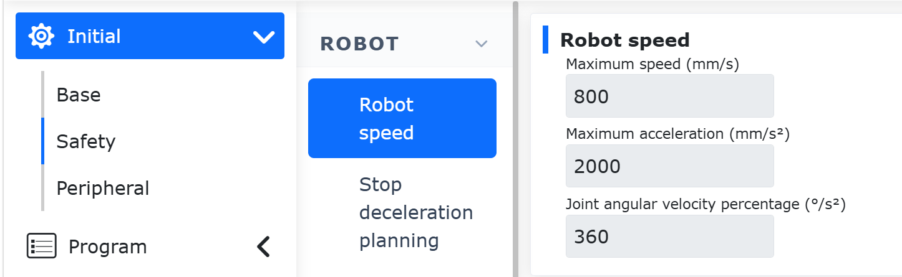

.. centered:: Figure 7.4-1 Robot Speed
 
Stop Deceleration Planning
++++++++++++++++++++++++++++++++++++++++++++++++++++++++++++++

Click the menu bar "Initial Setup" -> "Safety", and click the "Stop Deceleration Planning" submenu to enter the configuration interface.

- Free Stop: When entering stop, the angular velocity of each axis decelerates and stops according to the set stop deceleration percentage multiplied by the joint maximum acceleration;
- Synchronized Stop: When entering stop, the TCP pose velocity decelerates and stops according to the set stop deceleration percentage multiplied by the pose maximum acceleration;

Stop deceleration is a percentage of acceleration.

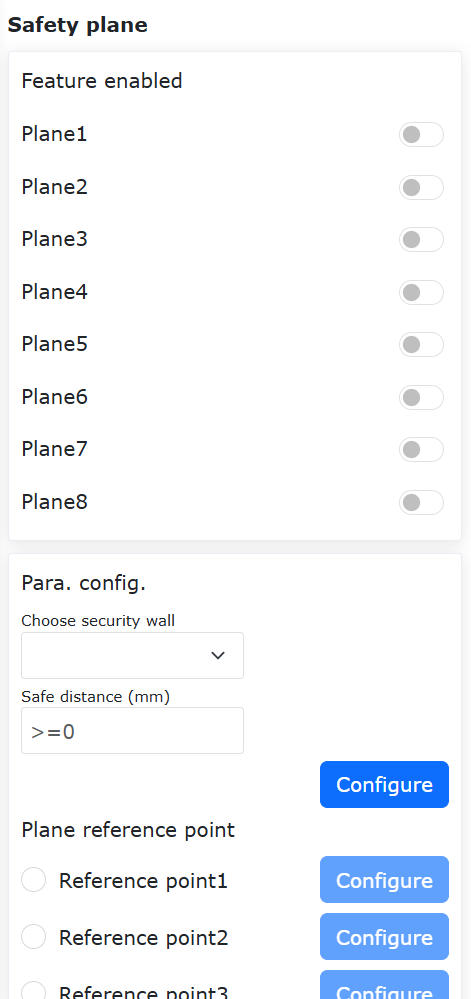

.. centered:: Figure 7.4-2 Robot Stop Deceleration Planning

Safety Stop
++++++++++++++++++++++++++++++++++++++++++++++++++++++++++++++

Click the menu bar "Initial Setup" -> "Safety", and click "Safety Stop" to enter the configuration interface to set the safety stop mode and safety stop strategy parameters.

Safety Stop Mode
**********************************************************************

When the safety stop mode is selected as "CR Certification", this mode mainly meets the safety requirements of the domestic robot certification system (CR Certification) and is suitable for domestic project acceptance or market access scenarios. CR Certification is an authoritative certification for Chinese robot products launched under the guidance of multiple national ministries and commissions, focusing on assessing the safety and reliability of robots.

In this mode, the system's safety stop function is configured and verified according to the industry specifications for domestic collaborative robots. In collaborative robot industry practice, such core safety functions are usually designed and evaluated with reference to a higher functional safety level to ensure absolute safety during human-robot collaboration.

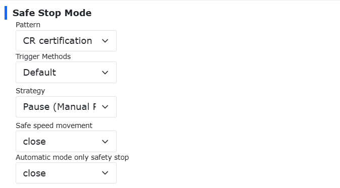

.. centered:: Figure 7.4-2-1 CR certification mode

Functional Safety is an internationally accepted engineering methodology, whose core goal is to ensure that the system can reliably enter a safe state when a fault occurs. For collaborative robots, functional safety is usually assessed according to ISO 13849-1 (Safety-related parts of control systems for machinery safety) & 10218, etc., to determine the performance level of safety-related control systems.

When the "Functional Safety" mode is selected, the implementation and verification of the safety stop function follow the international functional safety standard system. This mode is suitable for product export (such as compliance with the Machinery Directive in EU CE certification) or scenarios where customers have clear international standard basis for intrinsic safety.

.. note:: Note that after the functional safety mode is successfully configured, the control box needs to be restarted for the parameter changes of the safety control system to take effect.

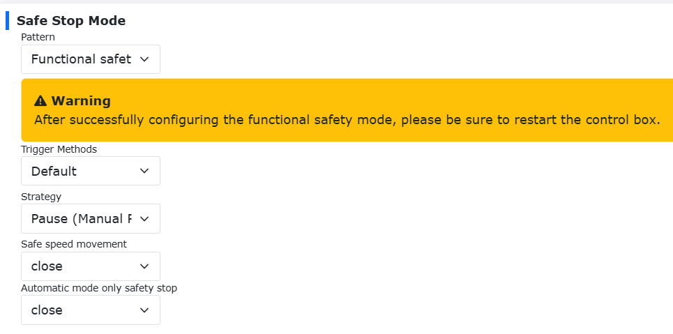

.. centered:: Figure 7.4-2-2 Functional safety mode

Trigger Method
**********************************************************************

When the safety stop trigger mode is set to "Dual Channel", both channels must be cleared and the warning must be manually cleared on the operation interface before the robot can be reset. In addition, a reduced mode option is added to the strategy configuration. When the user selects this strategy, the robot will enter reduced mode motion.

**Step1**: Click "Initial Setup" -> "Safety" -> "Safety Stop". The trigger mode can be selected as "Default" or "Dual Channel". The difference between the two is: in "Default" mode, the interface error is automatically cleared after triggering and recovery; in "Dual Channel" mode, the interface error must be manually cleared after triggering and recovery. "Safety Stop Strategy" can be selected as "Stop", "Pause", "Level 1 Reduced Mode", and "Level 2 Reduced Mode". The detailed descriptions are as follows: When "Stop" is selected, the robot will stop the current motion; when "Pause" is selected, the robot will pause the current motion, and after recovery and error clearing, it will resume the pause; when "Level 1 Reduced Mode" is selected, the robot will enter Level 1 reduced mode motion; when "Level 2 Reduced Mode" is selected, the robot will enter Level 2 reduced mode motion.

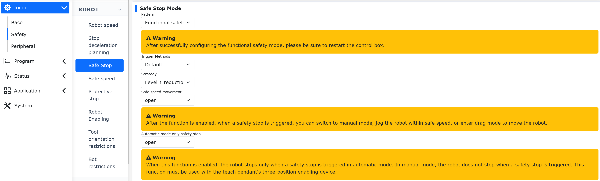

.. centered:: Figure 7.4-3 Robot Stop Deceleration Planning

**Step2**: When the trigger mode is set to "Default", the interface error can be automatically cleared after trigger recovery. When the trigger mode is set to "Dual Channel", the operation is: after trigger recovery, manually click the "Clear" operation in the upper right corner to reset the robot.

Safety Speed
++++++++++++++++++++++++++++++++++++++++++++++++++++++++++++++

Click the menu bar "Initial Setup" -> "Safety", and click "Safety Speed" to enter the configuration interface to set the safety speed. The TCP manual speed range is 1-1500mm/s.

The robot safety speed function is used in human-robot collaboration or dynamic environments to actively limit the robot's operating speed, controlling kinetic energy and impact force within safety thresholds, thereby preventing personnel injury in accidental contact and effectively protecting equipment and workpieces from collision damage.

**Step1**: Click "Initial Setup" -> "Safety" -> "Safety Speed" to set the safety speed parameters, mainly including three parts: "Function Enable", "Speed Limit", and "Post-Overspeed Mode".

Among them, Function Enable can be selected as "Disable", "Manual Mode Enable", and "All Modes Enable";

In Speed Limit, set the speed limit. When the robot's linear speed reaches this limit, it will be processed according to the parameters set in "Post-Overspeed Mode". "Post-Overspeed Mode" can be selected as "Stop and Alarm", "Auto Speed Limit", and "Disable After Stop and Alarm". Auto speed limit is only available in "Manual Mode Enable".

After setting the required parameters, no further operation is needed. The robot's motion will be processed according to the set parameters. The parameter settings are shown in the figure.

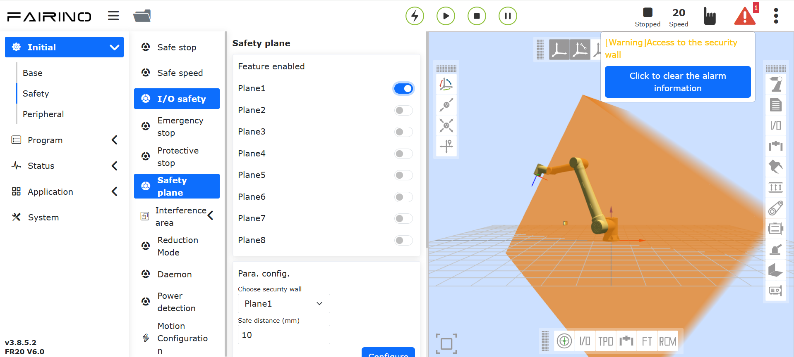

.. centered:: Figure 7.4-4 Safety Speed Parameter Settings

Emergency Stop
++++++++++++++++++++++++++++++++++++++++++++++++++++++++++++++

Click the menu bar "Initial Setup" -> "Safety", and click "Emergency Stop" to enter the configuration interface.

Emergency stop types 0, 1a, 1b, 2 can be set, stop time limit can be set, and stop distance limit can be set.

Through the controller sending to the control box board, emergency stop type 0 directly cuts off power to the control box board;

- Emergency stop type 1a: after deceleration stop, cuts off power to the robot body;
- Emergency stop type 1b: after deceleration stop, does not cut off power to the robot body, but disables the robot body;
- Emergency stop type 2: when emergency stop is pressed, the robot decelerates to a stop and remains enabled. After releasing the emergency stop, the robot should be able to operate normally.

.. note:: Note: Emergency stop shutdown is only supported by wide-voltage hardware.

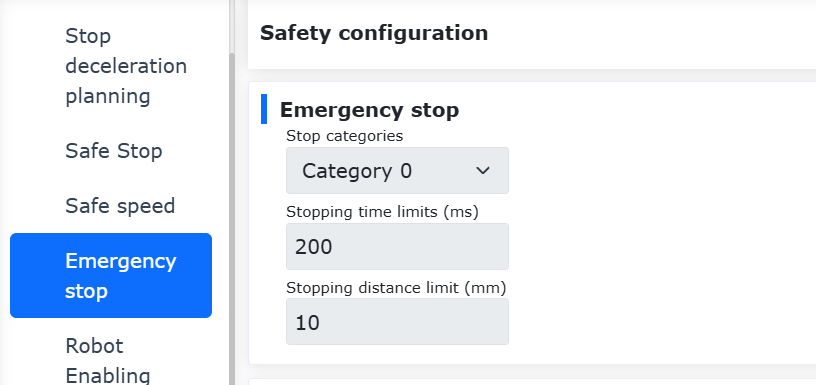

.. centered:: Figure 7.4-5 Emergency Stop Settings

Protective Stop
++++++++++++++++++++++++++++++++++++++++++++++++++++++++++++++

Click the menu bar "Initial Setup" -> "Safety", and click the "Protective Stop" submenu to enter the configuration interface.

There are three types of protective stop: 0, 1, and 2. In any mode, the safety stop function is triggered according to the control box safety stop signal, and the corresponding Cat.0, Cat.1, or Cat.2 stop function is executed according to the configured safety stop level. For protective stop type 0, the control box board cuts off power directly. For protective stop type 1, the control box board first notifies the controller to stop the robot, and then the controller feeds back to the control box board to cut off power. For protective stop type 2, the control box board notifies the controller to stop the robot.

- If the stop type is 0, the body power is cut off, and the joints execute a safe brake;
- If the stop type is 1, deceleration stop is performed, the body power is cut off, and the joints execute a safe brake;
- If the stop type is 2, deceleration stop is performed, the body power is maintained, and the joints do not execute a safe brake;

.. centered:: Figure 7.4-6 Protective Stop Configuration

Auto Enable on Power-On
++++++++++++++++++++++++++++++++++++++++++++++++++++++++++++++

Click the menu bar "Initial Setup" -> "Safety", and click the "Robot Enable" submenu to enter the configuration interface. You can choose whether the robot automatically enables on power-on or not.

.. centered:: Figure 7.4-7 Auto Enable on Power-On

Tool Orientation Limit (Only used in LA system)
++++++++++++++++++++++++++++++++++++++++++++++++++++++++++++++

Click the menu bar "Initial Setup" -> "Safety", and click the "Tool Orientation Limit" submenu to enter the configuration interface.

The tool orientation limit is a protective function acting on the robot's tool end Cartesian space to limit the robot's end posture motion range, including function enable setting, reference tool direction setting, and maximum deviation angle setting. The maximum deviation angle defines the maximum angular limit between the Z-axis of the tool end Cartesian coordinate system and the reference tool direction, which can usually be understood as a conical space.

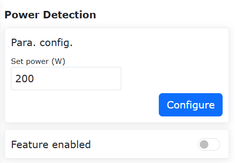

.. centered:: Figure 7.4-8 Tool Orientation Limit

Robot Limits (Only used in LA system)
++++++++++++++++++++++++++++++++++++++++++++++++++++++++++++++

Click the menu bar "Initial Setup" -> "Safety", and click the "Robot Limits" submenu to enter the configuration interface.

Robot limits include momentum and power, where the momentum limit is used to limit the robot's maximum momentum, and the power limit is used to limit the mechanical work done by the robot.

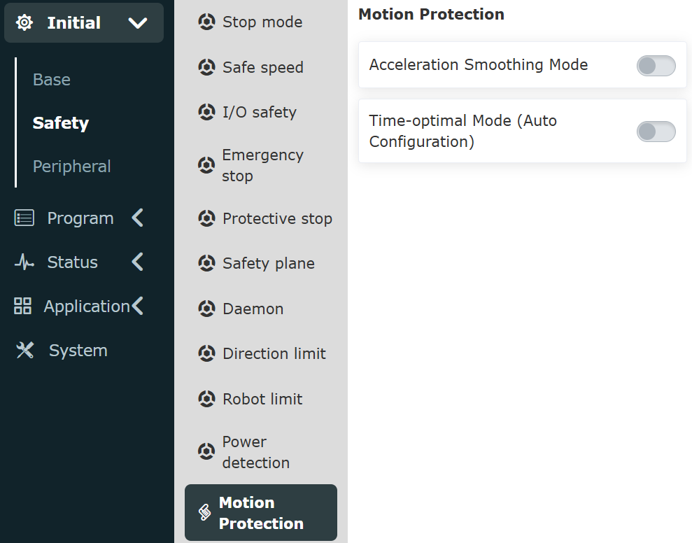

.. centered:: Figure 7.4-9 Robot Limits

Joints
~~~~~~~~~~~~~~~~~~~~~~~~~~~~~~~~~~~~~~~~~~~~~

Joint Soft Limits
++++++++++++++++++++++++++++++++++++++++++++++++++++++++++++++

Under the menu bar "Initial Setup" -> "Safety" -> "Joints", click "Joint Soft Limits" to enter the soft limit interface.

There may be other equipment within the robot's travel range. The limit angles can perform soft limiting on the robot, preventing the robot from moving beyond certain coordinate values and avoiding collisions. Triggering a soft limit causes the robot to stop automatically, with no stopping distance.

Administrators can use default values or enter angle values. By entering angle values, the positive and negative angles of the robot's joints can be limited separately. When the entered value exceeds the robot joint soft limit angle values listed in the robot basic parameters table in Section 2.1-Basic Parameters, the limit angle will be adjusted to the maximum settable value. When the robot reports a joint command out-of-limit error, it is necessary to enter drag mode and drag the robot joint back within the limit angle.

The joint soft limit protection function is an active protection mechanism that monitors the motion state of the robotic arm joints in real time and dynamically restricts the operator from exceeding the set soft limit range during drag teaching. This function makes soft limits meaningful even in drag teaching, thereby enhancing human-robot collaboration safety.

- **Step1**: Log in to the web interface and click "Initial Setup" -> "Safety" -> "Joints" -> "Joint Soft Limits" in sequence to enter the robot soft limit setting module.
- **Step2**: Based on the robot's actual working range, reasonably set the soft limits for each joint. At this time, check whether the current angular position of each robot joint is within the preset soft limit range. If yes, click "Apply" to send the preset soft limits. If not, move each joint within the preset range; otherwise, an over-limit prompt will appear when clicking "Apply", as shown in the figure below. At this time, you can jog or drag the over-limit joint in the direction toward the soft limit range to clear the error.
- **Step3**: After the soft limit range is successfully set, select "Enable" for "Joint Soft Limit Protection" to activate this function, as shown in the figure below. In drag mode, the set soft limits will take effect, and resistance will be felt when dragging near the soft limits.
- **Step4**: To disable the joint soft limit protection function, click "Joint Soft Limit Protection" to turn it off.

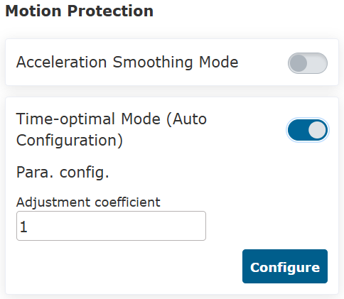

.. centered:: Figure 7.4-10 Joint Soft Limits

Collision Level
++++++++++++++++++++++++++++++++++++++++++++++++++++++++++++++

Under the menu bar "Initial Setup" -> "Safety" -> "Joints", click "Collision Level" to enter the collision level interface.
Collision levels are divided into levels 1 to 10. Levels 1 to 3 are more sensitive, and the robot needs to run at the recommended speed. You can also choose custom percentage settings, with 100% corresponding to level 10. As shown in the figure below:

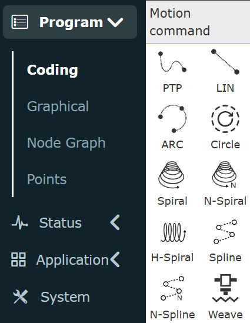

.. centered:: Figure 7.4-11 Collision Level Diagram

Collision strategies are "Stop on Collision", "Pause on Collision", and "Continue Motion". To avoid extrusion force between the robot and objects after collision, strategies "Gravity Torque Mode", "Oscillation Response Mode", and "Collision Rebound Mode" have been added. When triggered, all three strategies will switch from automatic or manual mode to drag mode, and then back to manual mode. The gravity torque mode will move away from the collision point based on the magnitude and direction of the collision force; the oscillation response mode will return to the collision position after moving away from it; the collision rebound mode will accelerate away from the collision point according to the set parameters.

In the "Collision Strategy" section, click the drop-down box to select "Collision Rebound Mode", and set the safety time to 1000ms, safety distance to 150mm, safety speed to 150mm/s, and safety factor for each joint to 5. The specific interface is shown in the figure below.

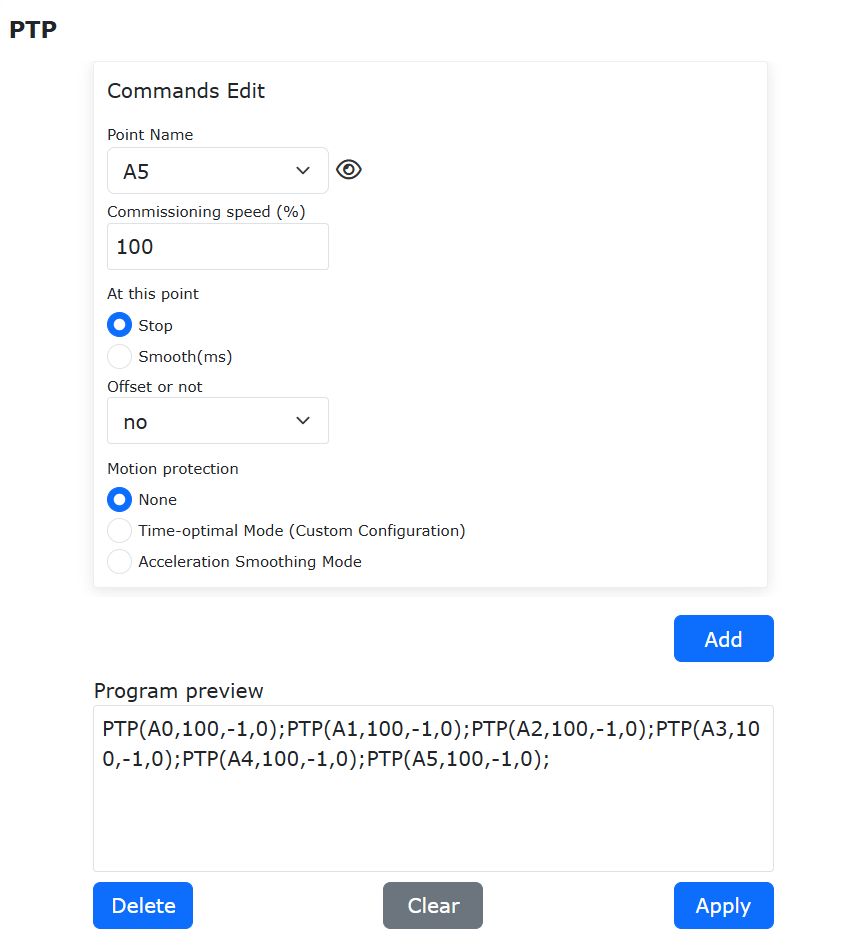

.. centered:: Figure 7.4-12 Collision Strategy: Collision Rebound Mode

Meaning of each parameter:

- Safety Time: Indicates the duration in drag mode after switching from automatic mode to drag mode, range [1000-2000]ms;
- Safety Distance: Indicates the position where the robot moves away from the collision point after collision, range [150-200]mm;
- Safety Speed: Indicates the maximum TCP speed at which the robot moves away from the collision point after collision. Exceeding this speed limit will constrain the rebound force, range [50-250]mm/s;
- Safety Factor: Indicates the decay rate of the rebound force. The smaller the coefficient, the faster the decay and the faster the rebound speed; the larger the coefficient, the slower the decay. Range [1-10], dimensionless.
- Before the robot enters drag mode, torque detection is required. This function is designed to prevent abnormal phenomena such as lifting or dropping after the robot enters drag mode due to incorrect load parameters or installation mode settings by the operator. If the joint torque is detected to exceed the allowable range, the controller will immediately report an error and prohibit the robot from entering drag mode.

Steps to enable the linear rack and pinion rail collision detection function:

- Step1: Ensure that both the rail and robot installation methods are front-mounted. Before enabling the linear rack and pinion rail collision detection function, check whether the installation method is front-mounted. Specifically, first ensure that the rail and robot installation methods are front-mounted. Then, click "Initial Setup" -> "Basic" -> "Installation" in sequence to enter the free installation page. If both "Base Rotation" and "Base Tilt" are 0, the software is set to front-mounted; otherwise, they must be changed to 0. If they are not 0, the interface will prompt an error.
- Step2: Enable the linear rack and pinion rail collision detection function and set parameters. Click "Initial Setup" -> "Safety" -> "Joints" -> "Collision Level" in sequence to enter the collision level setting page. After clicking the "Linear Rack and Pinion Rail Collision Detection" function slider, set the gear radius and slider mass. The gear radius can be calculated from the lead and reduction ratio. The slider mass does not include the robot and its end load. There are 11 rail level options, where Level 1 is the easiest to trigger collision and Level 10 is the most difficult. When the controller is first powered on and before the adaptation program is executed, the collision level should first be set to "Off".

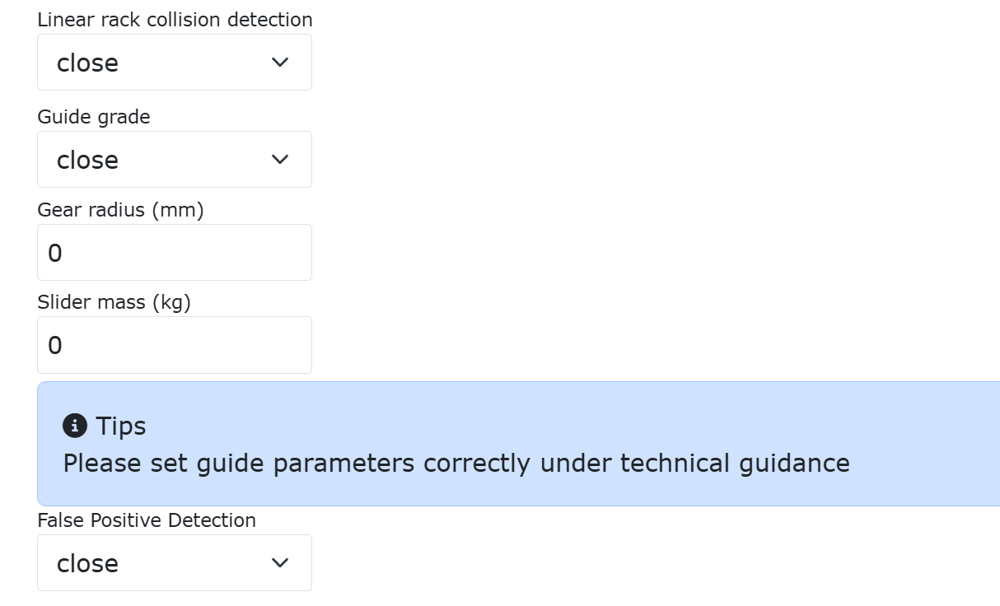

.. centered:: Figure 7.4-13 Linear Rack and Pinion Rail Collision Detection Function

- Step3: Execute the "Rail_Adaptation_Program.lua" program to adapt to the current rail. After each controller restart, the "Rail_Adaptation_Program.lua" program must be executed (to prevent changes in robot type and other factors from affecting the rail's dynamic characteristics). Before executing the program, ensure that the rail collision level is set to "Off". In automatic mode, run the LUA program at 100% interface speed. After one loop of the program is completed, the adaptation is complete and execution can be stopped.

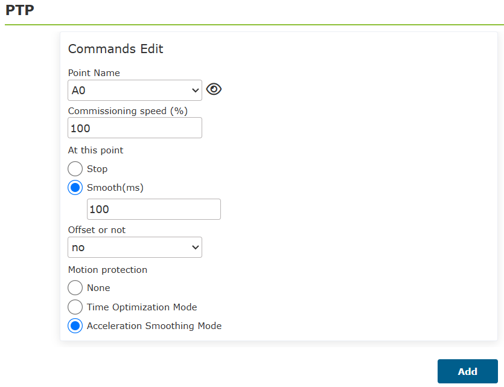

.. centered:: Figure 7.4-14 Execute "Rail_Adaptation_Program.lua" to Adapt to the Current Rail

- Step4: Reasonably set the rail collision level and execute tasks. Users can reasonably set the rail collision level based on the motor driver performance and task running speed. If the rail and robot operate asynchronously, collision with the robot or rail can trigger an "8-axis collision fault, resettable". At this time, the rail stops running, as shown in Figure 2-9. If the rail and robot operate synchronously, collision with the robot can trigger an alarm, causing the rail to stop running, while the robot reacts according to the set collision strategy.

Reduced Mode
++++++++++++++++++++++++++++++++++++++++++++++++++++++++++++++

Click the menu bar "Initial Setup" -> "Safety", and click the "Reduced Mode" submenu to enter the configuration interface. Select "Level 1/Level 2 Mode" to configure joint speed and end TCP speed.

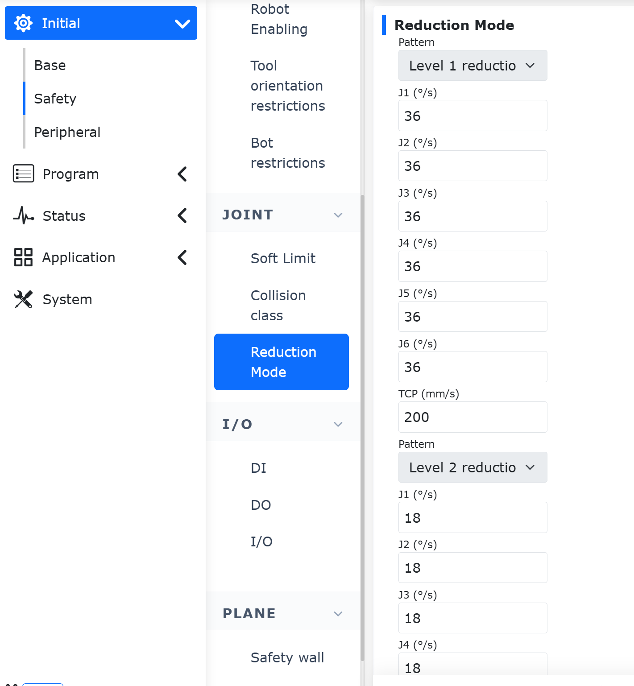

.. centered:: Figure 7.4-15 Reduced Mode

I/O
~~~~~~~~~~~~~~~~~~~~~~~~~~~~~~~~~~~~~~~~~~~~~~~~~~~
Click the menu bar "Initial Setup" -> "Safety", and click the "I/O" submenu to enter the configuration interface.

HMI provides the ability to set the safety state for 16 digital inputs and 16 digital outputs, which can be set to valid or invalid states. When the controller determines that it is in a safety state, the 16 digital inputs and 16 digital outputs are set to the safety state.

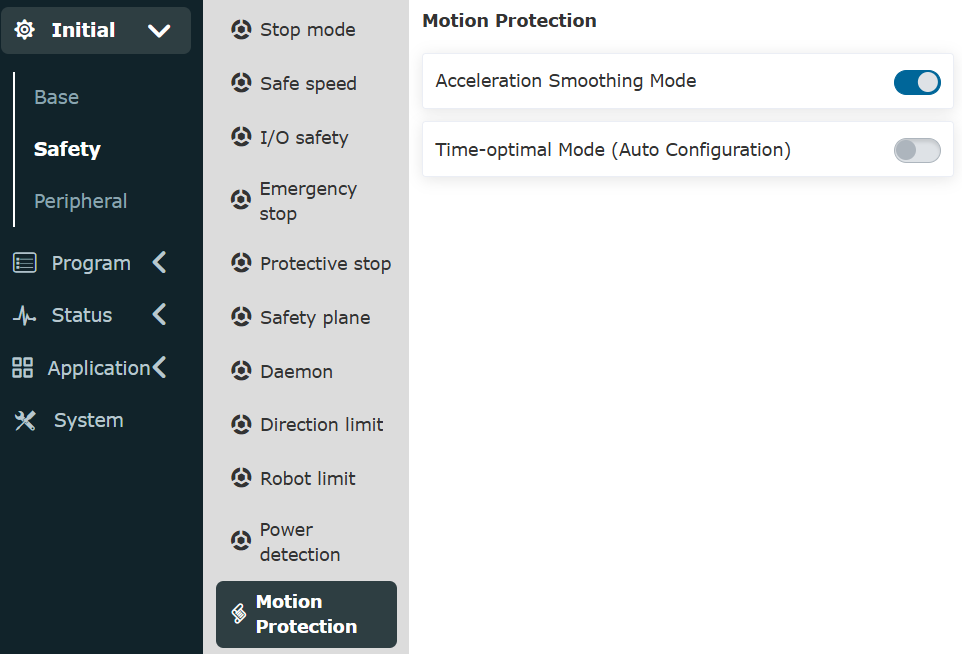

.. centered:: Figure 7.4-16 I/O Safety State Configuration

Under the LA system:

"I/O Safety" provides DIO safety functions. The safety function is dual-channel DI or DO. When a safety DI signal or safety state flag is triggered, the DO is output.

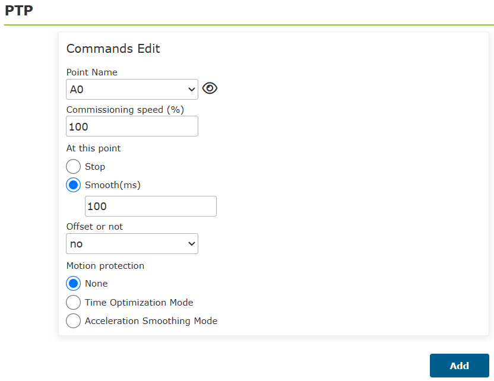

.. centered:: Figure 7.4-17 I/O Safety Function Configuration

Hardware
~~~~~~~~~~~~~~~~~~~~~~~~~~~~~~~~~~~~~~~~~~~~~~~~~~~

ServoJT Power Detection (Only used in QX system)
+++++++++++++++++++++++++++++++++++++++++++++++++++++++++++++++++++++++++++++++++++++++++++++++++++++++
Click the menu bar "Initial Setup" -> "Safety", and click the "Power Detection" submenu to enter the configuration interface.

When it acts directly on the robot's current loop (only with the servoJT command), it is used to limit the robot's maximum power. When it is detected that the robot power exceeds the limit value, power protection is performed.

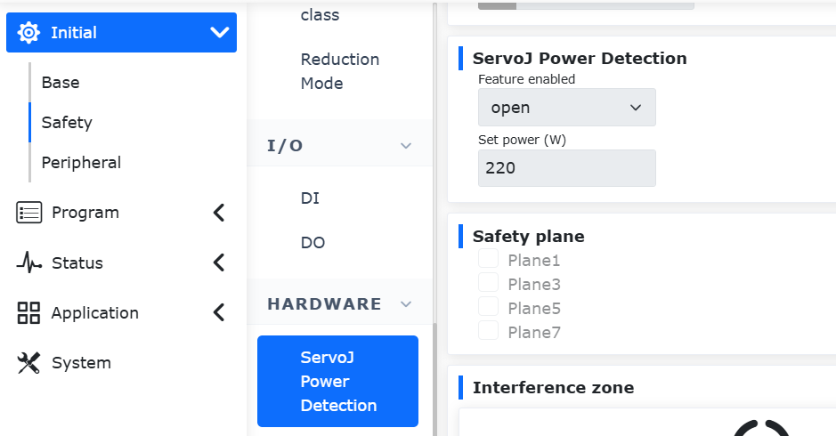

.. centered:: Figure 7.4-18 ServoJT Power Detection

Planes
~~~~~~~~~~~~~~~~~~~~~~~~~~~~~~~~~~~~~~~~~~~

Safety Wall
+++++++++++++++++++++++++++++++++++++++++++++++++++++++++++++++++++++++++++++++++++++++++++++++++++++++

Click the menu bar "Initial Setup" -> "Safety", and click the "Safety Wall Configuration" submenu to enter the configuration interface.

- Safety Wall Configuration: Click the Enable button to enable the corresponding safety wall. When a safety wall has not been configured with a safety range, an error will be prompted. Click the configuration button in the upper right corner, select the safety wall you want to set, automatically bring up the safety distance (optional, default is 0), and then click the "Set" button to set successfully.
- Safety Wall Reference Point Configuration: After selecting a safety wall, four reference points can be set. The first three points are plane reference points, used to confirm the plane of the set safety wall. The fourth point is the safety range reference point, used to confirm the safety range of the set safety wall.

If the reference points are set successfully, a green light will be displayed. Otherwise, a yellow light will be displayed until the reference points are successfully set and turn green. When all four reference points are successfully set, the safety range can be calculated. After successful calculation, the safety range parameter point status returns to default.

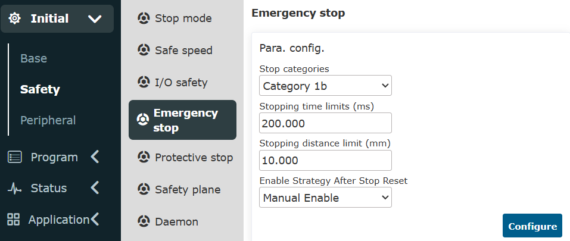

.. centered:: Figure 7.4-19 Safety Range Reference Point Settings

- Application Effect: Enable the successfully configured safety wall. Drag the robot. If the robot's end TCP is within the set safety range, the system is normal. If it is outside the set safety range, an error will be prompted.

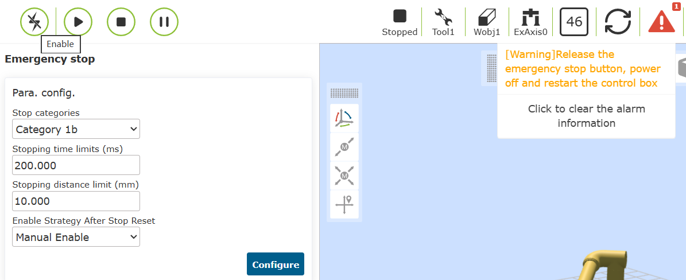

.. centered:: Figure 7.4-20 Effect After Successful Safety Range Settings

Interference Zone
+++++++++++++++++++++++++++++++++++++++++++++++++++++++++++++++++++++++++++++++++++++++++++++++++++++++

Under the menu bar "Initial Setup" -> "Safety" -> "Interference Zone", click the "Single" submenu item to enter the interference zone configuration interface.

We need to configure the interference method and the operation upon entering the interference zone. Interference methods are divided into "Axis Interference" and "Cuboid Interference".

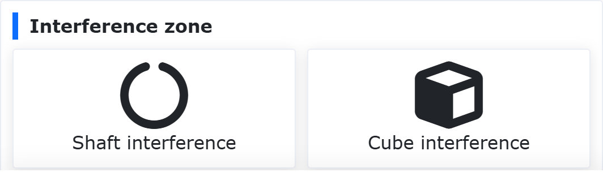

.. centered:: Figure 7.4-21 Interference Zone Methods

Click the interference zone icon, use the switch to control whether it is enabled, and click the configuration button in the upper right corner for parameter configuration.

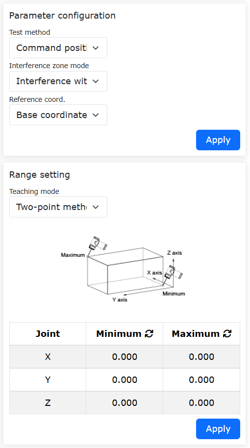

.. centered:: Figure 7.4-22 Interference Zone Configuration

First, configure the interference zone motion as "Continue Motion" or "Stop". Next, set the drag configuration upon entering the interference zone. Users can set the strategy after entering the interference zone in drag mode according to their needs: no drag restriction, impedance return, or switch back to manual mode.

When selecting Axis Interference, the axis interference parameters need to be configured. The detection method can be "Command Position" or "Feedback Position". The interference zone mode can be "Interference Within Range" or "Interference Outside Range". Next, set the range for each joint and whether the range for each joint is enabled. You can enter values, or use the "Refresh" icon after "Min" and "Max" to record the current robot position, and finally click Configure.

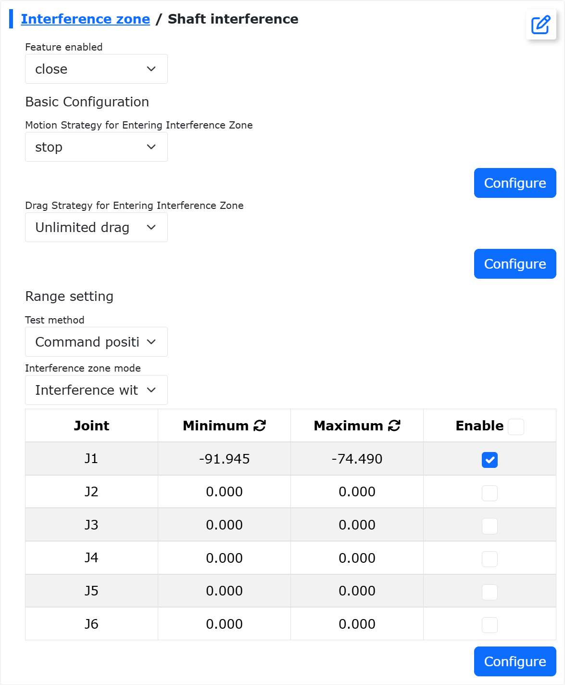

.. centered:: Figure 7.4-23 Axis Interference Configuration

When selecting Cuboid Interference, the cuboid interference parameters need to be configured. The detection method can be "Command Position" or "Feedback Position". The interference zone mode can be "Interference Within Range" or "Interference Outside Range". The reference coordinate system can be "Base Coordinate" or "Workpiece Coordinate", selected according to actual usage. Next, set the range. There are two methods for range setting. The first method is the "Two-Point Method", which uses two diagonal vertices of the cuboid. Positions can be entered or recorded through robot teaching. Finally, click Apply.

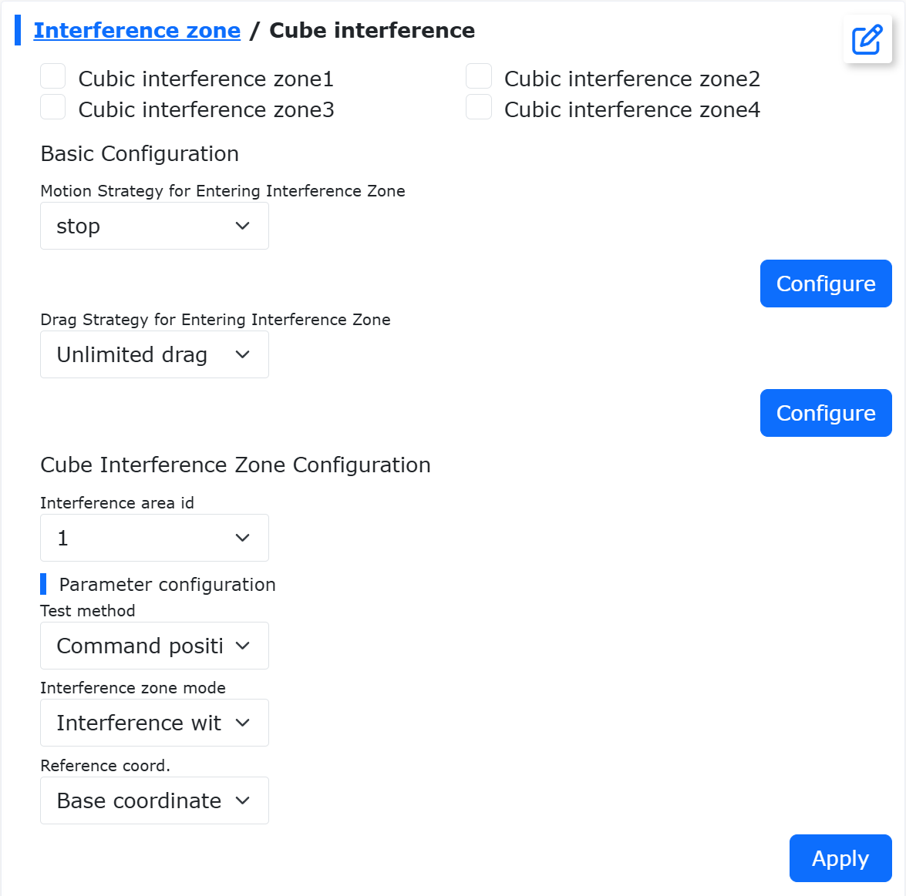

.. centered:: Figure 7.4-24 Cuboid Interference Configuration

The second method is the "Center Point + Side Length" method, where the center point of the cuboid and the side length of the cuboid form the interference zone. Positions can be entered or recorded through robot teaching. Finally, click Apply.

.. centered:: Figure 7.4-25 Cuboid Interference Configuration

Safety Log Storage Function
~~~~~~~~~~~~~~~~~~~~~~~~~~~~~~~~~~~~~~~~~~~~~~~~~~~~~~~~~~~~~~~~~~~~~~~~~~~~~~~~~~~~~~~~~~~~~~~

Background
+++++++++++++++++++++++++++++++++++++++++++++++++++++++++

The CE certification for FR series robots requires that all safety operation-related logs of the equipment be recorded and maintained separately. It also explicitly requires that the log storage include at least the last intervention evidence for each intervention type, that the tracking log data records for each intervention be kept for at least 5 years, and that the logs be protected against tampering.

Safety Log Management
+++++++++++++++++++++++++++++++++++++++++++++++++++++++++

Safety log management is maintained on the web page under "Initial Setup" -> "Safety". The "Safety Configuration Password" must be entered for verification first, and safety log management can only be performed after successful verification.

.. centered:: Figure 7.4-26 Safety Log Management

Safety logs are managed uniformly. To prevent an excessive log volume caused by abnormal operations, the current log storage volume can be seen intuitively on the page. Safety logs only retain the most recent 5 years, and each year's logs are stored uniformly in separate files according to log type. Click Export to export all logs.

Log types are divided into the following three categories:

.. centered:: Table 1-2 Safety Log Classification

.. list-table::
   :widths: 30 30 40
   :header-rows: 0
   :align: center

   * - **Log Category**
     - **Log File Name**
     - **Description**

   * - Parameter Modification
     - safetylog_params_2026.log
     - Robot safety configuration parameter modification, robot safety password modification

   * - Software/Firmware Version
     - safetylog_version_2026.log
     - Software/firmware version upgrade

   * - Log Operation
     - safetylog_operate_2026.log
     - Safety log deletion, export

Since safety logs must be kept for 5 years and cannot be deleted, to prevent abnormal writes from causing storage memory anomalies that affect system operation, safety logs adopt a tiered rate-limiting strategy based on used capacity. Before writing, the current used log space is checked, and the write frequency is dynamically adjusted.

.. centered:: Table 1-3 Safety Log Rate-Limiting Strategy

.. list-table::
   :widths: 20 30 20 30
   :header-rows: 0
   :align: center

   * - **Stage**
     - **Used Capacity**
     - **Write Frequency**
     - **Description**

   * - 1
     - <500M
     - Unlimited
     - Normal use (about 200M for 5 years)

   * - 2
     - 500M-1G
     - 1 second/entry
     - Slight rate limiting, no impact on experience

   * - 3
     - 1G-2.5G
     - 5 seconds/entry
     - Obvious anomaly, proactive speed reduction

   * - 4
     - 2.5G-4G
     - 30 seconds/entry
     - Severe anomaly, extreme delay time

   * - 5
     - >4G
     - Stop writing
     - Quota exhausted, no further log writing

In normal use, at a write volume of 1000 entries per day, the estimated usage over 5 years is within 200M. Therefore, when the memory exceeds 1G, there is clearly an abnormal situation. After exceeding 1G, the controller will proactively report a warning. It is necessary to proactively export and back up logs and recommend timely log cleanup.

.. centered:: Figure 7.4-27 Safety Log Abnormality Warning

The log export time depends on the total log size. Theoretically, the total log volume over 5 years will not exceed 200M. When logs exceed 1G, the download time exceeds 1 minute, and at the upper limit of 4G, the download time is about 5 minutes. After export, log cleanup can be performed. To ensure that abnormal evidence is not cleaned up, the current log deletion function only deletes logs from years other than the current year.

.. centered:: Figure 7.4-28 Safety Log Deletion

Functional Safety Functions
----------------------------------------------------------------

Functional Safety Description
~~~~~~~~~~~~~~~~~~~~~~~~~~~~~~~~~~~~~~~~~~~~~~~~~~~~~~~~~~~~~~~~~

This device is equipped with a safety-related control system used to automatically execute safety actions (such as emergency stop, guard door interlocking, etc.) when a hazardous situation is detected. These safety functions have been designed and verified in accordance with EN ISO 13849-1 / EN IEC 62061 standards and are an important part of achieving CE compliance.

To ensure that the safety functions remain effective, please note:

- Do not bypass or shield any safety device (such as removing interlock switches, short-circuiting safety circuits, blocking light curtains, etc.), otherwise it may cause serious personal injury.
- Do not modify safety-related components or software programs without authorization. Any modification, parameter change, or software update to the safety control system must be performed by the manufacturer or its authorized personnel, and a risk assessment must be carried out again.
- Network security: Do not connect the safety control system of this device to an unauthorized network; unauthorized digital access may cause the safety functions to fail.
- Maintenance and faults: If any safety device operates abnormally or fails, stop the machine immediately and contact the manufacturer or authorized service personnel. Only trained and authorized personnel may perform maintenance.

This device is conformity assessed in accordance with the EU Machinery Regulation (EU) 2023/1230. Safety function components are listed in the technical documentation for reference. The following is the specific list of safety functions.

.. centered:: Table 1-1  Safety Function List

.. list-table::
   :widths: 20 20 10 40 10
   :header-rows: 0
   :align: center

   * - **SF ID**
     - **Function Name**
     - **Level**
     - **Description**
     - **MTTFd***

   * - SF01
     - E-STOP on TPU-Teach Pendant Emergency Stop
     - PL d
     - | Execution monitoring of the emergency stop
       | Includes trigger logic for different trigger sources:
       | 1. In any mode, when the teach pendant emergency stop switch is triggered, it is converted to a control box emergency stop signal, and Cat.0 or Cat.1 stop action is executed according to the configured type, with interlocked position holding function
       | 2. In any mode, when the control box safety DI is triggered, it is converted to a control box emergency stop signal, and Cat.0 or Cat.1 stop action is executed according to the configured type, with interlocked position holding function
       | [Trigger event]: Emergency stop signal triggered
       | [Robot response]:
       | If the stop type is 0, the body power is cut off, the joints execute a safe brake, and position holding is monitored
       | If the stop type is 1, deceleration stop is performed, the body power is cut off, the joints execute a safe brake, and position holding is monitored	
     - 202.051

   * - SF02
     - Safeguard Stop
     - PL d
     - | Execution monitoring of the safeguard stop
       | In any mode, the safety stop function is triggered according to the control box safety stop signal. According to the configured safety stop level, the corresponding Cat.0, Cat.1, Cat.2 stop functions and the corresponding interlocked position holding function detection (Cat.0, Cat.1) or standstill detection + stopping distance + stopping time detection (Cat.2) are executed.
       | [Trigger event]: Safety stop signal triggered;
       | [Robot response]:
       | If the stop type is 0, the body power is cut off, the joints execute a safe brake, and position holding is monitored;
       | If the stop type is 1, deceleration stop is performed, the body power is cut off, the joints execute a safe brake, and position holding is monitored;
       | If the stop type is 2, deceleration stop is performed, the body power is maintained, the joints do not execute a safe brake and remain enabled, and standstill detection + stopping distance + stopping time detection are performed;	
     - 191.317

   * - SF03
     - Joint Position Limit
     - PL d
     - | Monitoring of the joint position limit
       | [Joint soft limits can be set for each joint. The safety board detects the joint position in real time. If the limit is exceeded, a Cat.2 stop action is executed, with interlocked standstill detection + stopping distance + stopping time detection.
       | [Trigger event]: The joint moves outside the limit position range;
       | [Robot response]: Fault alarm - soft limit exceeded, Cat.2 stop action is executed, with interlocked standstill detection + stopping distance + stopping time detection;
     - 158.530

   * - SF04
     - Joint Speed Limit
     - PL d
     - | Monitoring of the joint speed limit	
       | A joint speed limit can be set for each joint. According to the corresponding safety speed of the controller, the safety circuit detects whether the real-time speed of each robot joint exceeds the limit. If the limit is exceeded, a Cat.1 stop with interlocked position holding monitoring, or a Cat.2 stop with interlocked standstill detection + stopping distance + stopping time detection is performed.
       | [Trigger event]: The joint speed exceeds the set value;
       | [Robot response]: Fault alarm - speed exceeded. Optionally perform a Cat.1 stop with interlocked position holding monitoring, or by default perform a Cat.2 stop with interlocked standstill detection + stopping distance + stopping time detection;	
     - 158.530
          
   * - SF05
     - Joint Torque Limit
     - PL d
     - | Monitoring of the joint torque limit
       | A joint torque limit can be set for each joint. According to the corresponding safety torque of the controller, the safety circuit detects whether the real-time torque of each robot joint exceeds the limit. If the limit is exceeded, a Cat.2 stop is performed, with interlocked standstill detection + stopping distance + stopping time detection
       | [Trigger event]: The joint torque exceeds the set torque value
       | [Robot response]: Fault alarm - joint x torque exceeded, Cat.2 stop is performed, with interlocked standstill detection + stopping distance + stopping time detection
     - 62.808
     	          
   * - SF06
     - | TCP Pose Limit (safety plane, tool direction)
       | (Dynamic Limit can be adjusted dynamically; stop type not required)
       | (Corresponding limits are dynamically adjusted through configurable IO, dual circuit)
     - PL d
     - | Monitoring of the TCP pose limit
       | The TCP limit range and corresponding DI (up to 8 can be set) are set in advance on the corresponding controller page. When the DI is turned on, the corresponding limit is activated. When the TCP exceeds the limit range, a Cat.2 stop is performed, with interlocked standstill detection + stopping distance + stopping time detection
       | [Trigger event]: The TCP pose exceeds the set range
       | [Robot response]: Fault alarm - safety plane/tool direction exceeded, Cat.2 stop action is executed, with interlocked standstill detection + stopping distance + stopping time detection	
     - 70.072
          	          
   * - SF07
     - manual mode, reduced-speed
     - PL d
     - | Monitoring of reduced-speed manual mode
       | When the controller mode is in manual reduced-speed mode, it detects whether the TCP speed is ≤250mm/s. If the speed is exceeded, a Cat.0 or Cat.1 stop action is executed, with interlocked position holding monitoring.
       | [Trigger event]: The TCP speed exceeds the set speed
       | [Robot response]: Fault alarm - TCP overspeed, Cat.0 or Cat.1 stop action is executed, with interlocked position holding monitoring.	
     - 70.072
             	          
   * - SF08
     - TCP Force Limit
     - PL d
     - | Monitoring of the TCP force limit  
       | The controller can configure the TCP force limit. The safety circuit monitors the robot TCP force in real time. If the TCP force exceeds the limit value, a Cat.2 stop is performed, with interlocked standstill detection + stopping distance + stopping time detection
       | [Trigger event]: The TCP force exceeds the set limit
       | [Robot response]: Fault alarm - joint x collision fault, Cat.2 stop is performed, with interlocked standstill detection + stopping distance + stopping time detection	
     - 62.808
             	          
   * - SF09
     - Momentum Limit
     - PL d
     - | Monitoring of the momentum limit
       | The controller can configure the robot momentum limit. The safety circuit monitors the robot momentum in real time. If the robot momentum exceeds the limit value, a Cat.2 stop is performed, with interlocked standstill detection + stopping distance + stopping time detection
       | [Trigger event]: The momentum exceeds the set momentum limit
       | [Robot response]: Fault alarm - momentum exceeded, Cat.2 stop is performed, with interlocked standstill detection + stopping distance + stopping time detection	
     - 62.808
                	          
   * - SF10
     - Power Limit
     - PL d
     - | Monitoring of the power limit    
       | The controller can configure the robot power limit. The safety circuit monitors the robot power in real time. If the robot power exceeds the limit value, a Cat.2 stop is performed, with interlocked standstill detection + stopping distance + stopping time detection
       | [Trigger event]: The power exceeds the set power limit
       | [Robot response]: Fault alarm - power exceeded, Cat.2 stop is performed, with interlocked standstill detection + stopping distance + stopping time detection
     - 62.808
                	          
   * - SF11
     - System Emergency Stop Output
     - PL d
     - | Monitoring of the System Emergency Stop Output
       | When the emergency stop signal is triggered, the controller outputs an emergency stop signal DO.
       | [Trigger event]: Emergency stop signal triggered
       | [Robot response]:
       | Emergency stop type 0: System emergency stop signal output
       | Emergency stop type 1: System emergency stop signal output	
     - 191.317
                   	          
   * - SF12
     - Robot Moving State Output
     - PL d
     - | Monitoring of the Robot Moving State Output
       | When the robot is in the moving state, the controller outputs a motion signal DO
       | [Trigger event]: The robot is in the moving state
       | [Robot response]: Robot moving signal output	
     - 68.728
                	          
   * - SF13
     - Robot Not Stopping State Output
     - PL d
     - | Monitoring of the Robot Not Stopping State Output
       | When the robot is in the not stopping state, the controller outputs a not stopping signal DO
       | [Trigger event]: The robot is in the not stopping state
       | [Robot response]: Robot not stopping signal output	
     - 68.728

   * - SF14
     - Reduced Mode State Output
     - PL d
     - | Monitoring of the Reduced Mode State Output
       | When the robot is in the reduced state, the controller outputs a reduced signal DO
       | [Trigger event]: The robot is in reduced mode
       | [Robot response]: Reduced mode signal output	
     - 68.728
    
   * - SF15
     - Not Reduced Mode State Output
     - PL d
     - | Monitoring of the Not Reduced Mode State Output
       | When the robot is in the not reduced state, the controller outputs a not reduced signal DO
       | [Trigger event]: The robot is in not reduced mode
       | [Robot response]: Not reduced mode signal output	
     - 68.728
    
   * - SF16
     - 3P enabling function
     - PL d
     - | 3P enabling function
       | When the 3-position enabling switch is in position 1 or 3, the robot executes a Cat.2 stop, with interlocked standstill detection + stopping distance + stopping time detection
       | When the 3-position enabling switch is in position 2, the robot is enabled, with interlocked activation of manual reduced-speed mode and manual reduced-speed detection
       | [Trigger event]: In physical teach pendant mode, the 3-position enabling button is pressed to the middle position (position 2)
       | [Robot response]: Joints are enabled, joint safe brakes are released, the robot enters manual reduced-speed mode, with interlocked activation of manual reduced-speed mode and manual reduced-speed detection	
     - 68.728
         
   * - SF17
     - monitored-standstill (after Cat.2 stop)
     - PL d
     - | Monitored standstill
       | After the Cat.2 stop is completed, the safety circuit detects joint position changes according to the robot command and actual position. If the deviation exceeds the limit, a Cat.0 or Cat.1 stop is executed
       | [Trigger event]: When standstill and not running, the robot position changes abnormally
       | [Robot response]: The robot position change range exceeds the set value, and a Cat.0 or Cat.1 stop action is executed	
     - 47.515
            
   * - SF18
     - stopping time limiting (after Cat.2 stop)
     - PL d
     - | Monitoring of stopping time limit
       | After the Cat.2 stop signal is triggered, the safety circuit detects the stopping time according to the robot stop completion signal time. If the deviation exceeds the limit, a Cat.0 or Cat.1 stop is executed
       | [Trigger event]: When the robot triggers a stop
       | [Robot response]: When the robot triggers a stop, if the stopping time exceeds the set time, a Cat.0 or Cat.1 stop action is executed	
     - 47.515
            
   * - SF19
     - stopping distance limiting (after Cat.2 stop)
     - PL d
     - | Monitoring of stopping distance limit
       | When the Cat.2 stop signal is triggered, the robot position is recorded. The safety circuit obtains the stopping distance by subtracting the recorded position from the real-time actual position of the robot. If the deviation exceeds the limit, a Cat.0 or Cat.1 stop is executed
       | [Trigger event]: When the robot triggers a stop
       | [Robot response]: When the robot triggers a stop, if the stopping distance exceeds the set stopping distance, a Cat.0 or Cat.1 stop action is executed	
     - 47.515
                  
   * - SF20
     - hold-to-run control
     - PL d
     - | Hold-to-run control
       | When the 3-position enabling switch enters the middle position and the controller is in manual mode, after the end button is pressed, the robot enters the dragging state
       | When the 3-position enabling switch enters the middle position and the controller is in manual mode, after the end button is released, the robot enters a Cat.2 stop, with interlocked standstill detection + stopping distance + stopping time detection
       | [Trigger event]: The 3-position enabling switch enters the middle position, the controller is in manual mode, and the end button is pressed
       | [Robot response]: The robot enters the dragging state
       | [Trigger event]: The 3-position enabling switch enters the middle position, the controller is in manual mode, and the end button is released
       | [Robot response]: The robot enters a Cat.2 stop, with interlocked standstill detection + stopping distance + stopping time detection
     - 68.699
                      
   * - SF21
     - start/restart interlock
     - PL d
     - | Start/restart interlock
       | On start/restart/mode switching, the Cat.2 safety stop state is triggered. After the stop is executed, the controller cannot move, with interlocked standstill detection. The stop state must be reset by resetting the safety stop through DI before further operations can be performed
       | [Trigger event]: Controller start/restart/mode switching
       | [Robot response]: Interlock triggered, entering Cat.2 safety stop	
     - 191.317
                      
   * - SF22
     - reset safety
     - PL d
     - | Reset safety
       | When in the safety stop triggered state, first perform error/fault reset through DI. After the error/fault reset passes, perform stop state reset again through DI, and then the robot can exit the stop state
       | [Trigger event]: Safety stop state reset DI triggered
       | [Robot response]: The robot exits the safety stop	
     - 191.317
                         
   * - SF23
     - normal stop
     - PL d
     - | Normal stop
       | During robot motion, a normal stop is triggered through a DI signal. According to the configured safety stop type, a Cat.0 or Cat.1 stop action is executed
       | [Trigger event]: Stop motion triggered
       | [Robot response]: The robot executes a Cat.0 or Cat.1 stop action, with interlocked position holding monitoring	
     - 191.317
                         
   * - SF24
     - mode activation
     - PL d
     - | Mode activation
       | The controller mode can enter different modes through the software interface mode switch and the end button switch, including manual reduced-speed/manual high-speed/automatic/dragging
       | [Trigger event]: Software interface switch toggled
       | [Robot response]: The robot can switch between manual reduced-speed/manual high-speed/automatic modes, with interlocked manual reduced-speed monitoring/manual high-speed monitoring + manual high-speed time monitoring/manual reduced-speed monitoring/joint speed monitoring
       | [Trigger event]: End dragging switch toggled
       | [Robot response]: The robot can switch between manual reduced-speed/dragging modes, with interlocked manual reduced-speed monitoring/dragging speed monitoring/standstill monitoring	
     - 191.317
                             
   * - SF25
     - Position Holding Monitoring
     - PL d
     - | Monitoring of the Position Holding
       | When the controller changes from the enabled state to the disabled state, the position is recorded during brake engagement, and it continuously detects whether the difference between the robot joint position and the recorded position exceeds the limit threshold. If the threshold is exceeded, a Cat.0 operation is executed
       | [Trigger event]: During brake engagement, the robot joint position change exceeds the threshold
       | [Robot response]: Cat.0 operation is executed	
     - 47.515
                                
   * - SF26
     - single-point-of-control (local/remote control mode)
     - PL a
     - | single-point-of-control
       | The controller local mode and remote control mode are mutually exclusive. The mode is switched manually on the controller interface, and only one of them can be selected for control
       | [Trigger event]: Manually switch the control mode on the controller interface
       | [Robot response]: The controller can only select one mode at a time, shielding the operation of the other control source	
     - 10.6
                                   
   * - SF27
     - external control enable
     - PL a
     - | external control enable
       | The controller has a remote control mode. Entering and exiting the remote mode are both performed manually and locally on the controller interface. In this mode, other local control functions are shielded
       | [Trigger event]: Switch the remote control mode on the local interface
       | [Robot response]: The controller enters remote mode, shielding the operation of the local control source	
     - 10.6
                                   
   * - SF28
     - manual mode, high-speed
     - PL d
     - | Monitoring of high-speed manual mode
       | Click the manual high-speed switch button on the manual reduced-speed page. The controller can switch from manual reduced-speed to manual high-speed mode. The safety circuit detects whether the TCP speed is ≤1000mm/s. If the speed is exceeded, a Cat.0 or Cat.1 stop action is executed, with interlocked position holding monitoring
       | [Trigger event]: In high-speed mode, the TCP speed exceeds the set limit
       | [Robot response]: Deceleration stop is performed, fault alarm - TCP overspeed, Cat.0 or Cat.1 stop action is executed, with interlocked position holding monitoring	
     - 47.515

   * - SF29
     - manual mode, high-speed time limitation
     - PL d
     - | Monitoring of high-speed manual mode time limitation
       | When the controller mode is in manual high-speed mode and the 3-position switch exits the middle position, the safety circuit detects the duration. If it exceeds 5 min, the control box lowers the manual high-speed global speed to 25% (TCP speed 250mm/s), with interlocked corresponding speed monitoring (TCP speed ≤250mm/s)
       | [Trigger event]: In manual high-speed mode, the 3P switch is released for more than 5 min
       | [Robot response]: The control box lowers the manual high-speed speed to 250mm/s, with interlocked 250mm/s monitoring	
     - 68.728
   
   * - SF30
     - hand-guided control
     - PL d
     - | Monitoring of hand-guided control
       | When the 3-position switch is in the middle position and the end dragging button is pressed, the controller mode enters dragging mode. The safety circuit detects whether the TCP speed is ≤250mm/s (configurable speed limit), each joint speed is ≤45°/s (monitored through SF04, configurable speed limit, configurable Cat.0/Cat.1), each joint position limit (monitored through SF03, configurable range, Cat.2), and TCP pose limit (monitored through SF06, configurable range, Cat.2). If the speed is exceeded, a Cat.0 or Cat.1 stop action is executed, with interlocked position holding monitoring
       | [Trigger event]: The TCP speed exceeds the dragging limit speed (default 250mm/s, adjustable)
       | [Robot response]: Deceleration stop is performed, fault alarm - TCP overspeed, Cat.0 or Cat.1 stop action is executed, with interlocked position holding monitoring
     - 68.699
   
   * - SF31
     - Speed and separation monitoring (SSM)
     - PL d
     - | Speed and separation monitoring
       | When the controller mode is in automatic mode, the photoelectric switch/distance sensing switch externally connected through the control box DI detects the relative position of the machine and personnel. When the corresponding distance DI receives a signal, the control box performs a safety response. According to the corresponding distance, it enters level 1 reduction (configurable speed, default 200mm/s), level 2 reduction (configurable speed, default 100mm/s), or level 3 reduction (stop motion). At the same time, the safety circuit enters speed and separation monitoring. If the speed after entering reduction exceeds the speed corresponding to the corresponding reduction level, a Cat.0 or Cat.1 stop action is executed, with interlocked position holding monitoring
       | [Trigger event]: The TCP speed exceeds the set speed
       | [Robot response]: Deceleration stop is performed, fault alarm - TCP overspeed, Cat.0 or Cat.1 stop action is executed, with interlocked position holding monitoring	
     - 47.515

.. note:: Note: ***MTTFd**: Mean Time to Dangerous Failure (unit: years).

Joint Speed Limit
~~~~~~~~~~~~~~~~~~~~~~~~~~~~~~~~~~~~~~~~~~~~~~~~~~~~~~~~~~~~~~~~~
After functional safety is enabled, this function monitors the robot's joint feedback speed. When the motion speed exceeds the set value, a safety stop is executed.

The joint limit speed range is 1-180°/s, and the default is 45°/s.

.. centered:: Figure 7.5-1 Joint speed limit monitoring

.. note:: Note: When disabled, the function does not take effect; after being enabled, the function takes effect and monitoring begins.

Manual Mode - Reduced Speed
~~~~~~~~~~~~~~~~~~~~~~~~~~~~~~~~~~~~~~~~~~~~~~~~~~~~~~~~~~~~~~~~~

After functional safety is enabled, this function monitors the robot's feedback TCP speed in manual reduced-speed mode. When the motion speed exceeds the set value, a safety stop is executed.

The TCP limit speed range is 1-1000mm/s, and the default is 250mm/s.

.. centered:: Figure 7.5-2 Manual mode - reduced-speed monitoring

Manual Mode - High Speed
~~~~~~~~~~~~~~~~~~~~~~~~~~~~~~~~~~~~~~~~~~~~~~~~~~~~~~~~~~~~~~~~~

After functional safety is enabled, this function monitors the robot's feedback TCP speed in manual high-speed mode (using the TCP speed corresponding to the interface global speed as the limit). When the motion speed exceeds the set value, a safety stop is executed. After a speed exceeding 250mm/s is set, the disable time in manual high-speed mode is monitored. When the disable time exceeds the set value, the manual speed is reduced to 250mm/s.

The speed timeout range is 1-1000min, and the default is 5min.

.. centered:: Figure 7.5-3 Manual mode - high-speed monitoring

Dragging Speed Monitoring
~~~~~~~~~~~~~~~~~~~~~~~~~~~~~~~~~~~~~~~~~~~~~~~~~~~~~~~~~~~~~~~~~

After functional safety is enabled, this function monitors the robot's feedback TCP speed in dragging mode. When the dragging speed exceeds the set value, a safety stop is executed.

The TCP limit speed range is 1-1000mm/s, and the default is 250mm/s.

.. centered:: Figure 7.5-4 Dragging speed monitoring

Position Holding Monitoring
~~~~~~~~~~~~~~~~~~~~~~~~~~~~~~~~~~~~~~~~~~~~~~~~~~~~~~~~~~~~~~~~~

After functional safety is enabled, this function is used to monitor the robot position after it is disabled. When the change amount of each joint exceeds the set value, a safety stop is executed.

The TCP limit speed range is 1-1000mm/s.

.. centered:: Figure 7.5-5 Position holding monitoring

Manual High-Speed Mode
~~~~~~~~~~~~~~~~~~~~~~~~~~~~~~~~~~~~~~~~~~~~~~~~~~~~~~~~~~~~~~~~~

After functional safety is enabled, on the manual reduced-speed interface, click the "Enter Manual High Speed" button to enter manual high-speed mode. In this mode, the speed of JOG motion and command motion is not reduced.

.. centered:: Figure 7.5-6 Manual high-speed mode

Normal Stop
~~~~~~~~~~~~~~~~~~~~~~~~~~~~~~~~~~~~~~~~~~~~~~~~~~~~~~~~~~~~~~~~~

After functional safety is enabled, on the safety CI page, the "Normal Stop" digital input option can be selected. When the corresponding CI is triggered, the robot stops according to the configured protective stop level.

.. centered:: Figure 7.5-7 Normal stop

Safety Wall
~~~~~~~~~~~~~~~~~~~~~~~~~~~~~~~~~~~~~~~~~~~~~~~~~~~~~~~~~~~~~~~~~

After functional safety is enabled, on the safety CI page, the digital input options "Safety Wall 1" to "Safety Wall 8" can be selected. When the corresponding CI is triggered, the robot activates the corresponding safety wall monitoring. If it enters the safety wall limit range, the robot stops according to the configured protective stop level.

.. centered:: Figure 7.5-8 Safety wall

Reset Safety Stop State
~~~~~~~~~~~~~~~~~~~~~~~~~~~~~~~~~~~~~~~~~~~~~~~~~~~~~~~~~~~~~~~~~

After functional safety is enabled, on the safety CI page, the "Reset Safety Stop State" digital input option can be selected. When the corresponding CI is triggered, the robot clears the safety stop error code, and the controller can perform operations.

.. centered:: Figure 7.5-8 Reset safety stop state

Joint Torque Limit
~~~~~~~~~~~~~~~~~~~~~~~~~~~~~~~~~~~~~~~~~~~~~~~~~~~~~~~~~~~~~~~~~

Joint torque limit is a safety monitoring function. After it is enabled, the system monitors the torque of each joint in real time. When the actual torque of any joint exceeds the set torque limit percentage, the robot immediately stops running, and the interface prompts a joint torque limit exceeded fault.

The setting percentage range is 1%-100%, and the default is 100%;

.. centered:: Figure 7.5-9 Joint torque limit percentage

Corresponding fault handling suggestions:

1. If the limit exceeded fault is still frequently triggered under the 100% limit, it indicates that the current working condition is close to the robot's performance limit. It is recommended to first reduce the running speed or reduce the load/inertia.
2. If the fault still occurs after adjustment, it indicates that the task requirements may exceed the physical capability of the robot, and the operation plan needs to be re-evaluated.